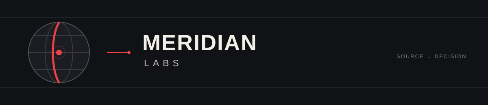
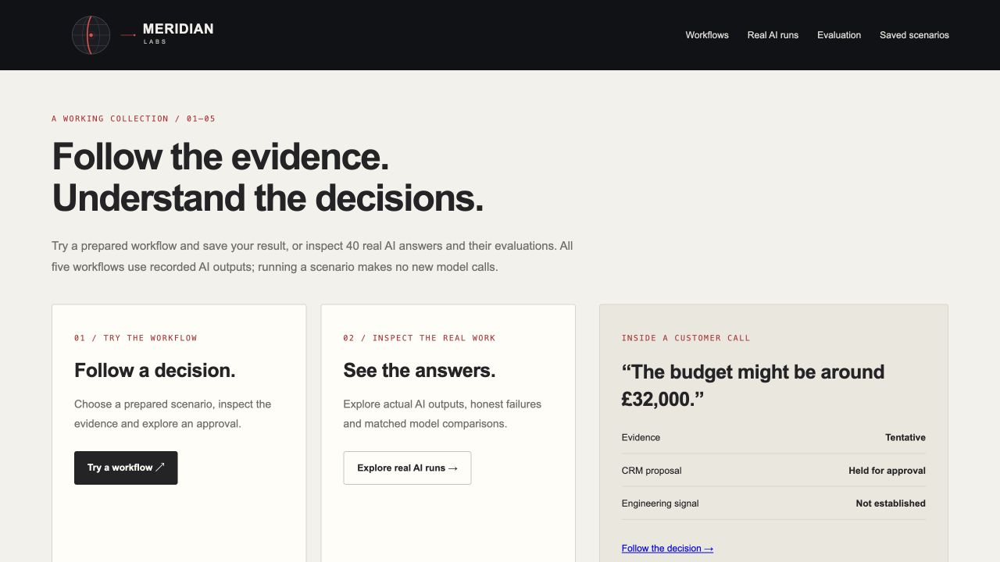

# Meridian Labs

This repository contains a runnable AI workflow demo, the code behind its evaluation and routing, n8n workflow sources, and public documentation for a separate private AI Performance Dashboard.

## Start here

| Goal | Go to |
| --- | --- |
| Try the demo online | [Open AI Workflows](https://meridian-ai-workflows-oli.misty-moon-5776.chatgpt.site/) |
| Run it on your computer | [Download and setup](#download-and-run-locally) |
| Understand the implementation | [Code and evidence](#inspect-the-code-and-evidence) |
| Check what a capability actually supports | [Capability evidence guide](docs/capability-check.md) |
| Understand the private dashboard | [Dashboard guide](docs/ai-performance-dashboard.md) |
| Understand the private Life OS app | [Life OS guide](docs/life-os.md) |
| Work on the repository with an agent | [AGENTS.md](AGENTS.md) |

## AI Workflows

Explore AI workflows from source evidence to finished outputs. Review a release announcement, a remediation plan, a security response, a SOC 2 evidence pack or the records created from a transcript. Each workflow includes model routes, editable cost estimates, source checks and a review decision.

<p>
  <a href="https://meridian-ai-workflows-oli.misty-moon-5776.chatgpt.site/"></a>
  <a href="https://github.com/olilifts88/meridian-labs/releases/download/ai-workflows-v1.2.1/meridian-ai-workflows.zip"></a>
  <a href="#download-and-run-locally"></a>
</p>

[Explore the code and evidence](#inspect-the-code-and-evidence)

**Online:** open the public site in your browser. No download, Python or installation is needed.

**Local download:** the ZIP contains just the demo. **Python 3.9+ and a desktop browser are all you need.** No package installation, AI account or API key. The scenarios use recorded answers and prepared business outputs; trying them makes no new AI calls.



## Start the demo

### Open online

[Open Meridian Labs AI Workflows](https://meridian-ai-workflows-oli.misty-moon-5776.chatgpt.site/), choose a workflow and click **Run workflow**. You can review the outputs and approved artefact pages in your browser.

### Download and run locally

1. **Download** `meridian-ai-workflows.zip` using the link above. On the release page, choose that file under **Assets**, not GitHub's automatic “Source code” downloads.
2. **Extract the ZIP** and open the `meridian-workflow-showcase` folder.
3. **Open a terminal in that folder** and start it:

   **Mac / Linux**

   ```sh
   python3 showcase_demo.py
   ```

   **Windows**

   ```powershell
   py showcase_demo.py
   ```

4. **Open [http://127.0.0.1:8766](http://127.0.0.1:8766)** in your browser. Keep the terminal open while you explore. Press **Ctrl+C** in the terminal to stop it.

If Python is not installed, install it from [python.org](https://www.python.org/downloads/) first. If you get stuck opening the folder or starting Python, use the [step-by-step setup and troubleshooting guide](docs/showcase-quickstart.md#setup-help).

## What to explore

Choose a workflow, inspect its sources and route, then click **Run workflow**. The output evaluation and artefact appear automatically beneath the run controls. **Quality and evidence** lets you compare answers, inspect changes, test a source conflict and follow each step to its output records. Review the source-linked checks and approve the output pages. **Request changes** offers a supported revision or lets you save a reviewer note. **Saved results** keeps the route, evidence and decision together.

The release workflow includes four scenarios and a branded release-note page. Transcript to action includes BD, customer-success and internal-meeting scenarios; its output hub opens CRM updates, engineering signals, pricing follow-ups, a company post and a searchable call library. Vulnerability review covers 40 asset findings, the security questionnaire has 20 questions, and SOC 2 covers 16 controls.

The main navigation focuses on workflows and saved results. The review-method page links to the original forty model answers as supporting evidence.

## The five workflows

| Workflow | What it demonstrates |
| --- | --- |
| **[Release notes](docs/workflow-guidance/pilot-release-notes.md)** | Turn confirmed product facts into a draft while respecting pilot and rollout limits. |
| **[Vulnerability review](docs/workflow-guidance/pilot-vulnerabilities.md)** | Match installed versions to supplied advisories and organise supported findings. |
| **[Security questionnaires](docs/workflow-guidance/pilot-questionnaire.md)** | Answer from policy evidence and hold unsupported claims. |
| **[SOC 2 evidence review](docs/workflow-guidance/pilot-soc2.md)** | Check evidence dates, ownership and approval; identify follow-up work. |
| **[Transcript to action](docs/call-crm.md)** | Turn a transcript into CRM updates, issue records, commercial follow-ups, team posts and searchable call knowledge. |

All data is fictional. Approvals affect the local simulation; they do not send messages or update external services. Saved results stay in the browser and address you used. The public site, a local copy, another browser and private browsing each have separate histories. They do not sync with one another or add results to the original benchmark.

## Model routing and costs

Each workflow has a recommended model route. Expand a step for its model, effort, quality check and cost. Compare lower-cost or deeper-review presets, or customise the route. The calculator supports GPT-6 Luna, GPT-6 Sol, GPT-6.1 Sol, GPT-6.1 Terra and GPT-6 Astra, with an official pricing check and saved rate snapshots. [How routing and costs work](docs/workflow-stage-routing.md).

## What the evaluation shows

The recorded pilot contains **10 examples × 2 models × 2 instruction styles = 40 answers**. It preserves the original answers and failures. The original checks passed 31/40; a separate checker correction passed 33/40. Nine answers have owner-review labels; the others are unreviewed.

The supporting model evidence connects those answers to measured tokens, generation time and **estimated API cost per answer and per check-passing answer**, including failed attempts in the cost. Estimates use a dated rate card and are separate from subscription bills. Automated checks and human judgments remain separate.

The new routing rules choose a smaller or stronger model, use ordinary code, or hold for missing evidence. They can select a matching recorded answer. These rules were written after the fixed-setup pilot, so their replay is an exploratory comparison, not a fresh routing experiment or proof of savings.

**[See the evaluation method](docs/evaluation-framework.md)** · **[Inspect routing rules and cost calculations](docs/showcase-routing-and-costs.md)** · **[Read the latest verification](docs/verification-quality-review-2026-11-02.md)**

## Inspect the code and evidence

The ZIP includes the source needed to run the demo. The full repository contains the wider implementation, tests and supporting guides.

| Follow this part | Source |
| --- | --- |
| Recorded answers and local scenario execution | [recorded_showcase.py](src/workflow_portfolio/recorded_showcase.py) |
| Routing rules and estimated costs | [showcase_measurement.py](src/workflow_portfolio/showcase_measurement.py), reusing the [router](src/workflow_portfolio/routing/router.py) and [token calculator](src/workflow_portfolio/usage/token_cost.py) |
| Current workflow UI and output pages | [demo-web/](demo-web/), with shared [route settings](demo-web/assets/route-settings.mjs) and [run-button state](demo-web/assets/run-button.mjs) |
| Local browser server | [web_demo.py](src/workflow_portfolio/web_demo.py) |
| Current saved results and supporting original answers | [visitor-results.mjs](demo-web/assets/visitor-results.mjs) and [run-explorer.mjs](demo-web/assets/run-explorer.mjs) |
| Workflow checks and CRM simulation | [showcase_assurance.py](src/workflow_portfolio/showcase_assurance.py) and [call_crm.py](src/workflow_portfolio/call_crm.py) |
| Frozen experiment and versioned rechecks | [ai_pilot.py](src/workflow_portfolio/ai_pilot.py) and the [recorded answers](examples/recorded-runs/pilot-2026-10-28.json) |
| Tests | [Python and JavaScript tests](tests/) |

## Working from the full repository

If you already have the source checkout, run `python3 showcase_demo.py` from its root and open the same address. The standalone path works without installing the project.

For the private owner-review screen and original developer demos, run `python3 demo.py serve --port 8766` instead. Stop the first server before starting another on the same port. Model calls remain disabled by default.

To rebuild the small ZIP, run `python3 scripts/build-workflow-showcase.py`. The [release guide](docs/showcase-release.md) explains its placement, checksum, source version and publication steps. Its explicit allowlist excludes private data, credentials and unrelated projects. No hosted account is needed for the downloadable demo.

## Inspect the engineering

- **[AI performance dashboard](docs/ai-performance-dashboard.md):** the six private-app tabs, backing sources, refresh timing and measurement boundaries. **[Dataflow diagrams](docs/dashboard-dataflows.md)** show the overall flow and each tab.
- **[Life OS app](docs/life-os.md):** Today, Tasks, Waiting and What’s On, with Notion behind the app, explicit decisions and source-update timing. **[Life OS dataflows](docs/life-os-dataflows.md)** show the overall path and each tab.
- **[Workflow guide](docs/recorded-workflows.md):** the five workflows, recorded answers, local checks and review boundaries.
- **[Capability evidence map](docs/capability-check.md):** find the implementation, tests, runnable commands, dated evidence and known gaps for a claim.
- **[Verification records](docs/verification-studio-routing-costs-2026-10-28.md):** the five workflow demos, routing, estimated costs and standalone-package checks.
- **[Release engineering](docs/release-workflows.md)** and **[architecture](docs/architecture.md):** domain contracts, the older SQLite service and separate n8n stages.
- **[Model routing](docs/model-routing.md):** policy compilation, direct-first planning and subscription execution boundaries.
- **[Usage and evaluation](docs/usage-and-evaluation.md):** supplied-log measurement, token-cost estimation and matched saved-output comparisons.
- **[Shared evaluation framework](docs/evaluation-framework.md):** one record contract across five workflows, frozen-input saved-output comparisons, individual criterion findings and explicit usage gaps. It reuses existing evaluators, usage modules and feedback validation.
- **[Workflow guidance](docs/workflow-guidance/README.md):** two scoped example guides and where they are used.
- **[Repository security](docs/security.md)** and **[deployment boundaries](docs/n8n-deployment.md):** operational controls and optional external integrations.

## Repeat the checks

The repository checks include the browser logic and a fresh build of the downloadable demo. The download check verifies file hashes and asset parity, starts the extracted server offline on a free port, checks its pages and pricing fallback, and confirms server-side writes remain blocked.

```sh
npm run test:web
npm run test:download
```

```sh
python3 demo.py evaluate
python3 demo.py benchmark
python3 scripts/capability_check.py
```

The shared evaluation runs 19 workflow scenarios and 17 deliberately corrupted outputs across all five workflows, including Transcript to action. The shared benchmark compares reference and corrupted saved outputs across all five workflows; these are checker probes, not a live model leaderboard. Calls adds tests for cumulative evidence, stale approvals, selective/bulk review and corrupted records. [Call and benchmark verification](docs/verification-call-crm-2026-10-27.md) records the observed checks. The capability checker reports code/test references and recorded evidence; it does not infer passing tests from their presence. Its `--verify` mode runs the offline checks, requiring Node 24+ as well as Python. See the [guide](docs/capability-check.md).

The [portfolio map](docs/portfolio-map.md) and [implementation plan](docs/rebuild-plan.md) retain historical context and future work. Hosted source connections, external publication, questionnaire submission, universal model routing and achieved cost savings are not claimed by these demos.

## Folder guide

| Folder | What is in it |
| --- | --- |
| [`src/workflow_portfolio/`](src/workflow_portfolio/) | Python workflow code, browser demo, routing, evaluation and usage modules |
| [`tests/`](tests/) | Python and JavaScript checks, including failure and duplicate-run cases |
| [`examples/`](examples/) | Fictional inputs, example policies and dated model-review summaries |
| [`docs/`](docs/) | Setup, architecture, verification and operating guidance; `workflow-guidance/` holds the two scoped guides |
| [`demo-web/`](demo-web/) | Canonical browser pages, workflow data and shared controls used by the download and hosted export |
| [`assets/`](assets/) | Meridian Labs banner and dashboard preview image |
| [`.n8n/`](.n8n/) | Editable n8n workflow sources with separate Code-node files |
| [`exports/n8n/`](exports/n8n/) | Generated workflows for import; change `.n8n/` sources first |
| [`scripts/`](scripts/) | Capability checks and n8n build, validation, deploy and mirror tools |
| [`.github/workflows/`](.github/workflows/) | Automated checks and the manual code-only example |
| [`workflow_portfolio/`](workflow_portfolio/) | Small source-checkout launcher for the older module commands; implementation remains in `src/` |

`demo.py` starts the AI workflows, including the separate `/calls` journey. `capabilities.json` maps claims to their supporting files. Private receipts, workspace identifiers and local release records are ignored by Git and are not part of the shared repository.
