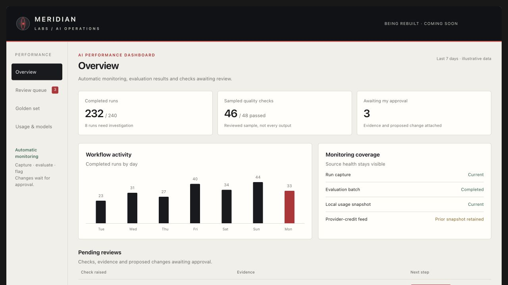

# AI Performance Dashboard — coming soon

I'm building an AI Performance Dashboard to understand whether my AI workflows are operating properly, whether their outputs meet the standard, which models suit the work and what the recorded usage shows.

The dashboard is being rebuilt as a separate project. The repository walkthrough is coming soon. The description below is its intended behavior, not a claim that every feed and view is complete.

## Design preview

The [interactive design preview](previews/ai-performance-dashboard.html) contains Overview, Review queue, Golden set, and Usage/model views. Download the repository and open that file in a browser. All figures and review interactions are illustrative; it does not connect to personal data or apply changes. The preview is self-contained and needs no accounts or network access.

## What it should show

| Question | Intended view | Decision it should support |
| --- | --- | --- |
| **Are workflows operating properly?** | Recorded tasks, completion/failure states, source errors and evidence of routing decisions | Find broken runs, missing expected evidence and recurring operational issues |
| **Is the work good?** | Output evaluations, sampled quality reviews, human feedback and repeated failure types | Improve instructions and checks while keeping automated judgments separate from human verdicts |
| **Which model suits this work?** | Matched task comparisons with quality, retries and available token/cost measurements | Choose a model from comparable evidence, rather than a general model ranking |
| **What are we consuming?** | Recorded usage trends, model contributions, estimated token value and separate provider-credit views | Understand consumption and decide where closer investigation is useful |

## Golden set and evaluation setup

I reviewed examples and source evidence, recorded expected outcomes and defined rules for what should pass, fail or remain unanswered. My earlier work includes a Python evaluation harness and golden test set for document processing. Those examples let me rerun known cases as the workflow changes.

I reviewed outputs and traces to understand what good looks like before relying on automated checks. Schema validation, comparisons with reference outcomes and human judgment serve different purposes. A golden set is reviewed reference data; it does not mean I fine-tuned a model.

The rebuild extends this approach into the monitoring and approval loop. Private golden examples are not published in this repository, and I do not claim that a complete dashboard-wide golden set has been released here.

## How I intend it to work

My aim is an almost fully automated operating loop: capture runs, evaluate outputs and traces, identify repeated failures, and prepare evidence-backed recommendations. My main interaction should be reviewing checks and approving specific proposed changes. Approved changes should be validated, applied and rechecked automatically, with a recorded outcome. Unapproved changes must remain pending.

Workflow runs and evaluation records should feed the dashboard with their source, date and measurement scope. A task outcome should remain distinct from an independent quality review. Requested model settings should remain distinct from runtime identity. Missing data should stay visibly unavailable instead of turning into zero.

Usage views should distinguish measured local records from unobserved cloud/mobile work, estimated token value from subscription billing, and provider credits from token counts. A model-cost share can suggest where to investigate; it does not prove that model was a poor choice. Savings require comparable task quality and complete cost coverage.

The dashboard should surface useful findings and actionable failures, retain the last dated result when a source fails, and make its supporting records inspectable. It should not silently change model defaults or treat an automated assessment as human approval.

## What is already in this repository

The [usage and evaluation modules](usage-and-evaluation.md), [model routing components](model-routing.md) and [workflow output checks](showcase.md) provide supporting building blocks. They do not constitute an integrated dashboard. The rebuilt collection/reporting loop and a reviewer-ready dashboard walkthrough are coming soon.

No live personal dashboard data, account telemetry or private Notion links are included here.
