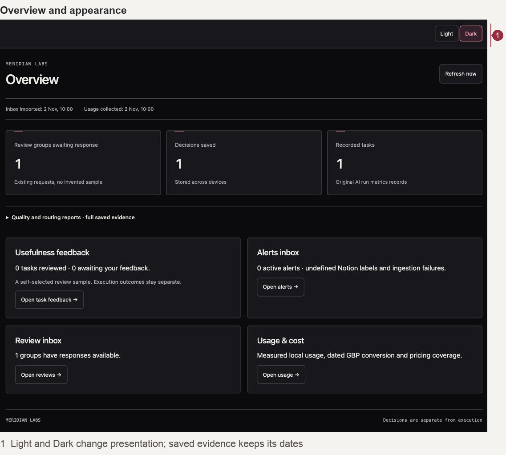
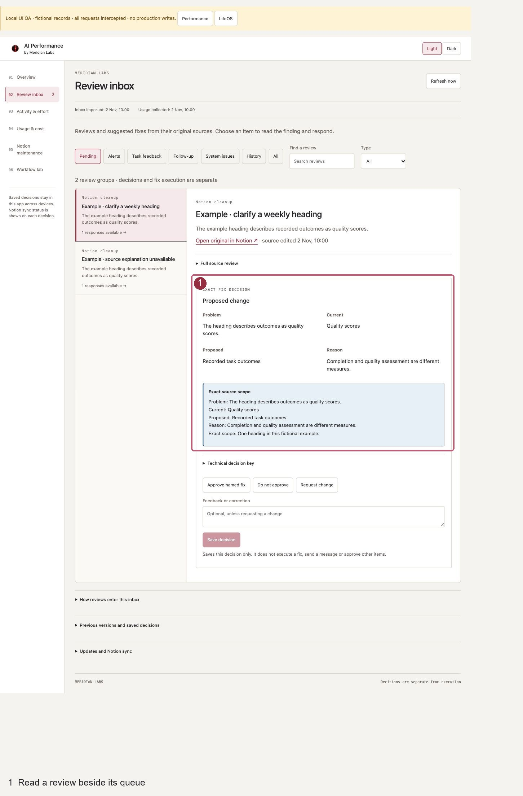
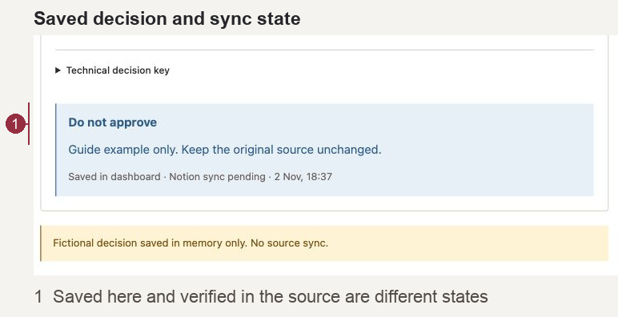
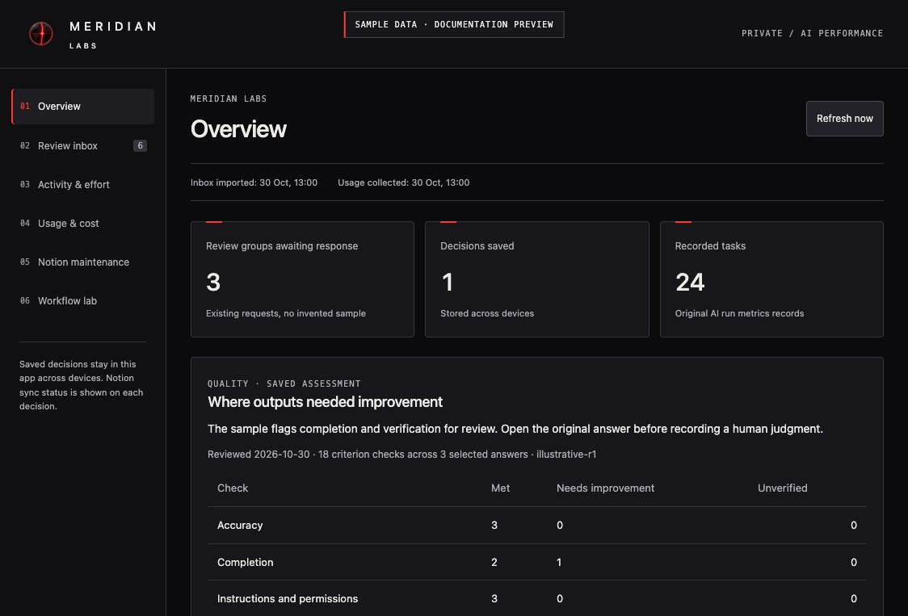
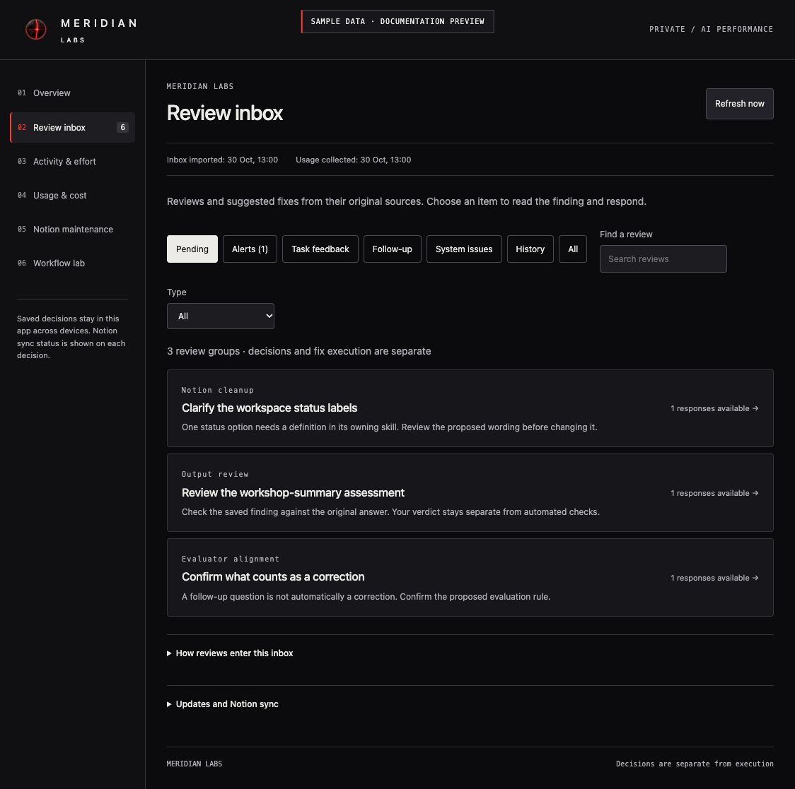
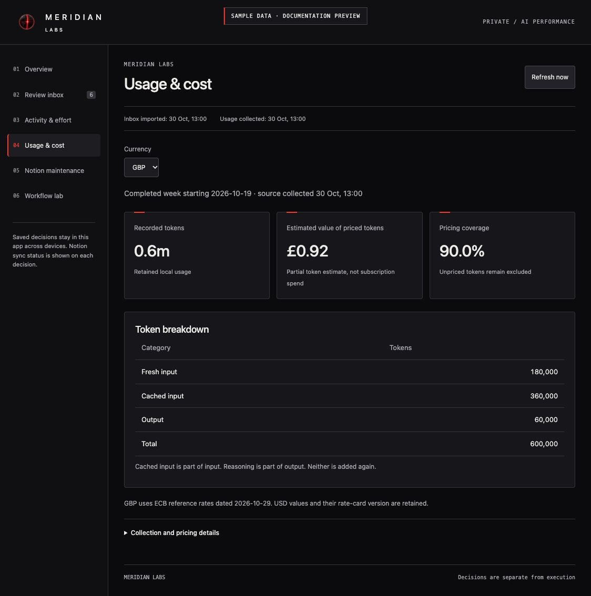

# AI performance dashboard

## Illustrated UI refresh · 2 November 2026

Implementation review edition. Saved source/build is distinct from production publication. Every screenshot uses fictional sample data; counts and dates illustrate the controls, not current account facts. The yellow QA banner belongs only to the development fixture route.

| Coverage | UI refresh edition | Publication |
| --- | --- | --- |
| performance | 2 November 2026 source | Pending separate decision |

Follow this short route from the first step. Light and Dark retain the same actions and data.

### Step 1 · Start with Overview and appearance

Open AI Performance. Choose Light or Dark in the compact header. Overview shows retained counts and entry points; expand Quality and routing reports for the full saved evidence.

**Expected result and background:** The choice is saved on this browser and shared with Life OS on the same origin. Counts and reports keep their original definitions and source dates.

### Step 2 · Read a review beside its queue

Open Review inbox, keep the appropriate status/type filter and select a review. Read the finding, source link, source-backed Problem, Current, Proposed and Reason, then Exact source scope.

**Expected result and background:** Technical decision key and Full source review retain identity, revisions and detailed history. If an explanation was not supplied, the app says so; it does not infer a fix from an ID.

### Step 3 · Save one explicit response

Choose the named response, add Feedback or correction if needed, then Save decision. Read the saved choice and its sync state. History retains previous decisions.

**Expected result and background:** Saving records that one revision-bound choice. It does not execute a fix or approve other items. Saved in dashboard and Synced to Notion are different states. The screenshot is an isolated memory-only example.

### If something looks wrong

- No matching records: clear search and status filters. A selected detail can remain visible while its queue is filtered.
- Old source date or failed update: retain the last dated result and inspect the specific failure; do not interpret it as an empty successful read.
- Saved choice still pending: read its sync state before repeating it. A saved decision is not proof its source was updated.
- Theme does not persist: storage may be unavailable. The current page remains usable; choose the mode again after reopening.
- On a phone: use Back to return from selected detail, or Close/Escape for a dialog. Physical-device delivery remains a separate check.

### Terms

**Snapshot:** the last saved source read. **Source check:** a fixed rule checked against supplied evidence. **Exact scope:** the change a named choice refers to. **Sync pending:** saved here, not yet verified in the source. **Prepared scenario:** a deterministic replay, not a new AI call.

## Retained operating reference and earlier release context

A private Meridian dashboard brings together operational reviews, recorded tasks, usage estimates and workflow evidence. It opens on Overview, followed by Review inbox, Activity & effort, Usage & cost, Notion maintenance and Workflow lab. The public repository documents its design and data contracts; the owner’s hosted app, personal records and source access are separate from the downloadable workflow demo.

The interface offers saved Light and Dark modes. Source dates and missing measurements remain visible. A saved task outcome, an automated quality check and a person’s judgment are separate records.

These screenshots use the current interface with fictional sample data. The figures illustrate the layout; they are not measured usage, costs, quality results or achieved savings.

## Updates and refresh controls

- **Immediate app writes:** review decisions, task usefulness feedback and workflow receipt imports are durable in the app database after saved-data readback.
- **While open:** the dashboard rereads saved app data every minute and on reopening. Manual-refresh status is checked every 15 seconds. These reads do not collect source data.
- **Every 12 hours:** the existing connected reporting job is configured to mirror reviews, task records, saved quality/routing evidence, live label-definition checks and dated exchange rates. The Mac, app and connected source access must be available.
- **Local usage:** where the code-only uploader is enabled, the existing 15-minute Mac catch-up checks for changed retained logs and verifies the uploaded aggregates. The Mac must be awake, online and authorised. The Monday 09:00 Europe/London full-workflow gate and the 12-hour connected mirror remain separate; the mirror reuses the latest verified report.
- **Refresh now:** choose this tab, several tabs or all tabs. A confirmation explains shared sources and other affected tabs. Selecting activity or usage requests a fresh local-log scan. No business workflow or model comparison is replayed.

A durable request queue distinguishes waiting, dispatched, running, completed and failed. An ordinary HTTPS courier checks for explicit requests every 30 seconds and queues the existing connected collector. It does not sync every source at that interval or call a model while idle. Its credential stays in process memory. A Mac restart or expired credential requires the connected reporting job to re-arm it. Requests wait when collection is unavailable.

The collector verifies source writes and app readback before recording completion. A failed source retains its previous dated family. Duplicate active scopes coalesce; different families are merged without erasing unrelated data. These are configured operating rules, not proof of a naturally timed execution or phone delivery.

## Overview

What you see:

- Review groups awaiting responses, saved decisions and recorded operational tasks.
- Saved answer-quality findings and routing examples, with inspection dates and scope.
- Active label/source alerts, task-feedback counts and links into the inbox and usage detail.

Backing data and freshness:

- Shared inbox records, app decisions and original AI Run Metrics rows.
- Validated saved quality/routing projections from the existing evaluator, separate from task counts.
- Task and review mirrors are configured every 12 hours; app decisions appear immediately after saving.
- Quality judgments change only when the existing bounded weekly review inspects new or changed evidence. Reimporting a judgment preserves its inspection date.
- Historical examples are not a whole-account reliability rate, current routing compliance score or model ranking.

## Review inbox

What you see:

- Review groups with their original finding, source links and available choices.
- Pending, alerts, task feedback, follow-up, system-issue and history filters.
- Named-fix decisions, evaluator questions and existing human-verdict controls.
- Saved decision status, source-sync receipt and prior source revisions.
- One alert for each undefined database/property/option, with the exact label and links to its database and owning skill.
- Task feedback using Useful unchanged, Needed edits or Not useful.

Backing data and freshness:

- Complete review handoffs on their original owning records and the Suggested Fixes inventory, including applied, denied, superseded and test history. The retired Life OS page is not an ingestion source.
- App decisions and review revisions stored durably in D1; saving is immediate.
- New source reviews use the existing cloud Life Sweep publisher or 12-hour connected mirror. Decisions back to Notion use the 12-hour mirror or Refresh now; recording a choice and executing a fix remain separate.
- Seven registered live Notion schemas are compared with their current Active owning skills. Adding an option does not itself trigger a Notion agent; the connected 12-hour sync and requested refresh perform the check.
- Read failures create ingestion errors and retain prior label alerts. A complete successful scan resolves definitions added or options removed.
- Task-feedback requests enter only when the visitor chooses a task in Activity & effort. They are bound to that evidence revision and saved immediately in the app, without changing a Notion outcome or human verdict.
- A choice is revision-bound. Recording it does not execute the proposed fix. Missing or changed source evidence blocks an old decision.

## Activity & effort

What you see:

- Retained model-response records, typed tool/action events and local rollout inventory.
- A searchable task history and source-linked task detail.
- Available attempts, duration, execution environment and measurement coverage.
- Capability filters on explicitly tagged records and “What can scale with this setup?” guidance.
- Add a chosen task to the review inbox for usefulness feedback.

Backing data and freshness:

- Original AI Run Metrics rows, projected without replacing their schema or identities. The everyday Notion view shows Run, Run day, Run type, Skill, Execution environment, Strategy, Requested worker model, Outcome and Evidence. A separate Routing & delegation view exposes requested and evidenced actual assignments. Other properties and their data remain stored and hidden.
- Retained Codex log reports for aggregate response/action inventory; these are separate from task records.
- Tasks mirror every 12 hours. The enabled code-only uploader can update local aggregates through the existing 15-minute catch-up; the full weekly workflow and explicit Refresh now remain separate.
- Capability labels cover inspected records only. Missing attempts, technical retries, worker lineage, duration and whole-task tokens stay unavailable. A follow-up question is not automatically a retry or correction.

### Run visibility and saved-record recovery

Run visibility shows saved task states, refresh requests, capture deliveries and review choices. Search by task name or run ID, then filter by record type and state. These lists overlap and must not be added together as task totals. Running describes the last saved state; it is not a live agent heartbeat.

For a capture delivery needing attention, **Check saved record** looks up its original source identity and verifies the retained evidence. It does not create a page, overwrite source fields or repeat the business action. Restore the existing connection before checking again after an access failure. Missing, ambiguous or human-edited evidence stays retained for investigation. Verified capture delivery does not establish answer quality or fix execution.

Service-relaunch and rejected-access recovery checks passed on 10 November 2026 using the existing implementation. Isolated persisted requests, decisions and source dates survived the service restart; recovery completed a missing receipt without repeating the applied change. Read-only hosted checks recovered from rejected access, and repeated publisher checks recognised already-saved data. Private receipts remain with the owner. This does not establish a deliberately tested full Mac reboot or natural credential expiry.

## Usage & cost

What you see:

- The latest completed week, measured tokens and the priced subset’s estimated value.
- Fresh input, cached input and output, with pricing coverage.
- GBP by default, an optional USD display, the exchange-rate date and rate-card version.

Backing data and freshness:

- The existing local token collector and versioned token-cost calculation.
- Public ECB reference rates for the dated USD-to-GBP conversion, carried forward if unavailable.
- Local usage can update through the enabled 15-minute Mac catch-up or an explicit usage/activity refresh. The weekly full-workflow gate remains in place. The 12-hour mirror reuses the latest verified report and can refresh FX.
- Cached input is part of input; reasoning is part of output. Neither is added twice. Unpriced tokens are excluded from cost estimates, not valued at zero.
- Estimates are API-equivalent token values. They are not subscription bills, tool charges, complete account usage or demonstrated savings.

## Notion maintenance

What you see:

- Existing cleanup proposals and label-definition alerts with a route into the same review inbox.
- Source detail and the decision state of each proposal.
- A separate disclosure explaining additional workspace checks, such as homepage links, duplicates, freshness, structure and filing.

Backing data and freshness:

- The same complete Suggested Fixes and owning-record review handoffs as the inbox, plus the seven registered schema/owning-skill mappings.
- The configured 12-hour mirror or Refresh now updates that shared family; the confirmation also names Overview and Review inbox.
- The page consumes existing maintenance findings. Listing possible checks does not establish that a whole-workspace scanner is installed.
- The label comparison is read-only. It does not repair definitions, edit records, add databases or send email.
- Decisions and later verified fix application retain separate receipts.

## Workflow lab

What you see:

- The frozen fictional workflow pilot, original answers, revised checks and saved human labels.
- Configuration comparisons and inspectable run evidence.
- JSON receipt import, a downloadable format guide and deduplication by stable run ID.

Backing data and freshness:

- Saved pilot outputs and versioned checks, separate from operational task metrics.
- Additional run receipts stored in D1 immediately after a validated import and readback.
- Refresh now rereads saved lab records and shared FX. It does not generate additional answers.
- Optional tokens, model calls, tools, attempts, retries and duration remain unknown when omitted. Rechecking an answer does not add another run.

## Source contracts

The app keeps source records, measurements, derived projections and presentation separate. A review has its original source identity and revision; a decision has the authenticated actor, selected field, choice and receipt. Task projections reuse existing run properties. Usage retains collection date, token categories, rate-card identity and pricing coverage. Every displayed family has its own evidence date.

Only a complete verified source inventory replaces a family. Source failures never turn into an empty inbox or zero usage. Previous review revisions, resolved alerts and authenticated decisions are retained. Task-feedback history is stored independently of source imports. No database column is deleted to simplify the display. A hidden field remains available for future measurement. Source access and private Site writer access are verified separately; a Site credential grants no Notion permission.

[See the overall and per-tab dataflow diagrams](dashboard-dataflows.md). [Usage and evaluation modules](usage-and-evaluation.md) and [routing components](model-routing.md) explain supporting repository code.
