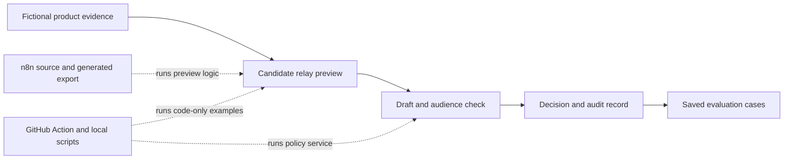

# Architecture and decisions

## Scope

This page describes the older release service and n8n examples. The [workflow tour](portfolio-tour.md) explains the five browser journeys and their local knowledge fixtures. The demo uses in-memory release validation. Its optional live session separately stores private model receipts and idempotent local delivery records; these are not external publication receipts. Test results must identify the execution surface they cover.

The [calls/Notion CRM journey](call-crm.md) reuses the loopback server and adds domain-specific evidence/priority rules plus mock views. All five browser workflows emit the [shared evaluation contract](evaluation-framework.md). The benchmark adapter calls each existing evaluator; usage collection, token valuation and human calibration retain their existing modules. The separate connected Notion demo is editable data, not an installed browser-to-Notion writer.

## Release service and n8n examples

Meridian Labs keeps two ways to run the same kind of work in one repository: an n8n canvas with separate Code-node files, and scripts or GitHub Actions that do not need n8n. The first audience check exists in both forms but only the code-only version has durable records and review transitions. The separate candidate relay currently prepares a preview in both environments; it does not yet persist state or send a card. [The portfolio map](portfolio-map.md) marks those gaps before anyone treats the examples as a complete release system.

The reference uses four boundaries:

1. **Evidence:** a product change has a stable ID, content kind, PR links, release stage and exact permitted audiences. The evidence adapter would fetch this from trusted systems in a real deployment. The draft cannot define its own review policy.
2. **Draft:** a generator can propose text and structured claims. The example loads the proposal from JSON so it runs offline.
3. **Policy:** deterministic checks compare structured claims with the evidence. These checks do not depend on model wording or confidence. A failed claim blocks publication.
4. **Decision store:** SQLite saves one record per product change and indexes its PR links. Adding a PR updates that record; using a PR for a different change is rejected. It appends an event for each submission, correction or engineer decision.

The saved-case benchmark applies the same evidence and standards to each model. It rejects unmatched case sets, reports each case's result, and totals illustrative tokens only when usage is present for every case. Comparing models without matched tasks would mix model behaviour with task difficulty.

For routine content, successful checks reach `ready_to_publish`. A new guide pauses for an engineer and reaches that state only after approval. Nothing leaves this demo. The example does not attempt to prove prose quality with string matching; the phrase checks are explicitly an offline stand-in for human-approved examples. A real evaluation layer would test factuality, usefulness and source grounding on a maintained set of cases, then send selected failures for human review.

The public API would need authenticated, tenant-scoped adapters before real customer data could enter this flow. The test suite covers the important state transitions and rollout mismatch. It does not establish readiness for a defence or regulated deployment.
