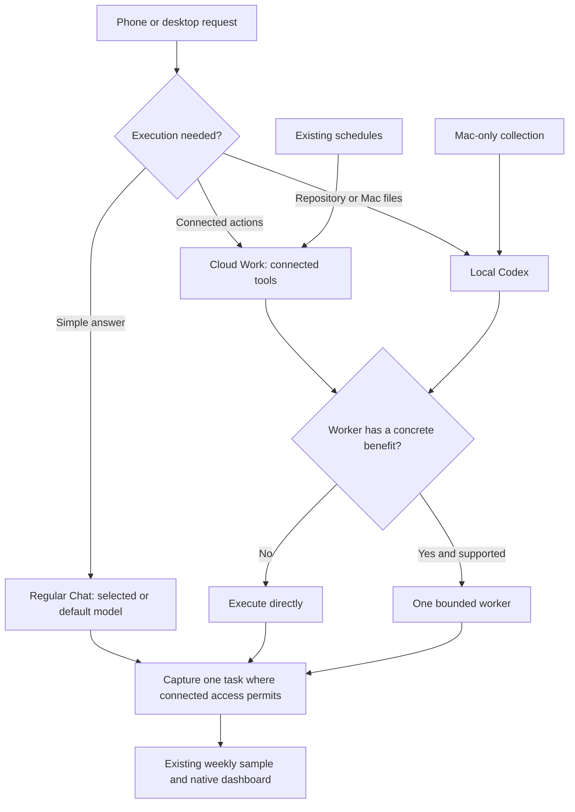

# One policy, supported execution paths

The design uses one canonical policy source and selective delegation. A provider adapter executes requests; the policy does not switch the main chat model.

## Behaviour and evidence

| Path | Intended behaviour | Verified scope |
| --- | --- | --- |
| Regular Chat | Answer suitable requests directly; record task/outcome when capture succeeds | Connected capture has succeeded on an ordinary local Codex request, not a universal ordinary-Chat collector |
| Cloud Work | Use connected tools; delegate selectively | Current cross-device automatic adoption remains unverified |
| Local Codex | Direct execution by default; explicit subscription-only adapter for bounded worker work | Explicit summary pilot and ordinary direct-request acceptance passed; actual backend identity not exposed |
| Local prompt hook | Load the canonical policy pointer at each user prompt | Installed local handler detected; this is instruction delivery, not enforced routing |
| Scheduled work | Retain existing cadence and use durable skill guidance | Three cloud schedule pointers and two local prompts checked; post-change natural execution remains pending |

`execution.plan_execution` is a pure decision helper with trusted coordinator inputs. It does not classify arbitrary user text, intercept ChatGPT, call models or grant permissions. The local prompt hook is a thin pointer, not another policy engine. A suitable direct answer may have unknown actual-model metadata. Missing metadata alone never triggers a worker.

## Maintenance

- Models stay in the policy source; exported snapshots are pinned local operational inputs. Refresh them when source policy changes.
- Task skills own mode, sources, permissions and success. The navigator owns execution decisions. The evaluator owns evidence and quality.
- Existing weekly review reuses one sample of up to five changed/new tasks. Counting and deduplication use code, not additional model calls.
- Leave paused monitors paused. Do not add polling or routing schedulers. Never replay business actions to obtain metrics.
- Subscription authentication only for this deployment. No API fallback or added Notion-agent jobs. Existing Notion-agent credits remain a separate unit.

## Acceptance matrix

Record expected/observed outcomes with evidence. Test ordinary requests without a routing reminder, direct and justified-worker paths, tool/permission boundaries, same-goal record reuse, missing configuration and failure recovery. Inspect phone and desktop separately. A manual run does not prove a natural timer run. Missing evidence is Partial, not a pass. No remote Mac access or hook should be assumed to work while the Mac is off.

The operational policy source and live account configuration are deliberately not embedded in this reusable reference. Configure an HTTPS policy entry point for a local hook. Repository fixtures use example.com.
