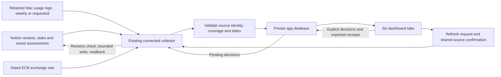
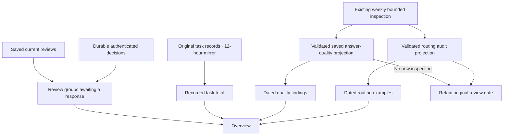
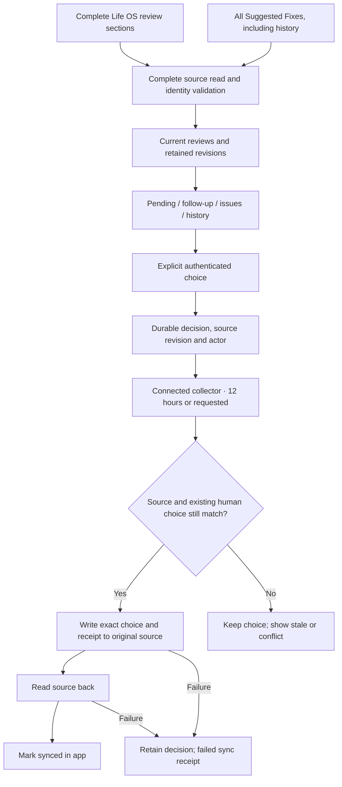
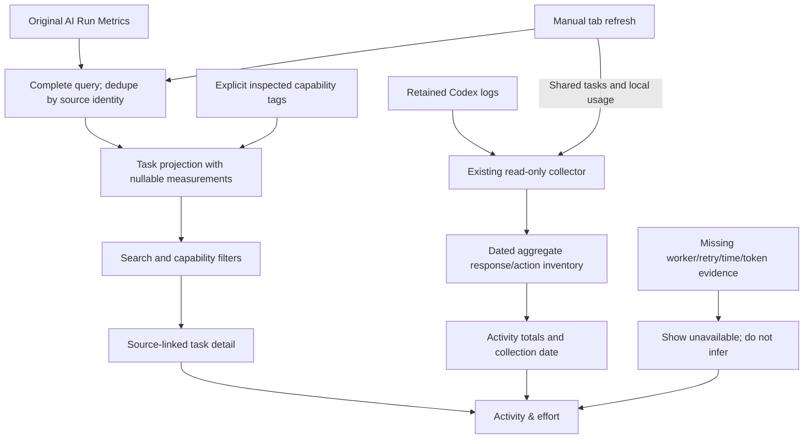
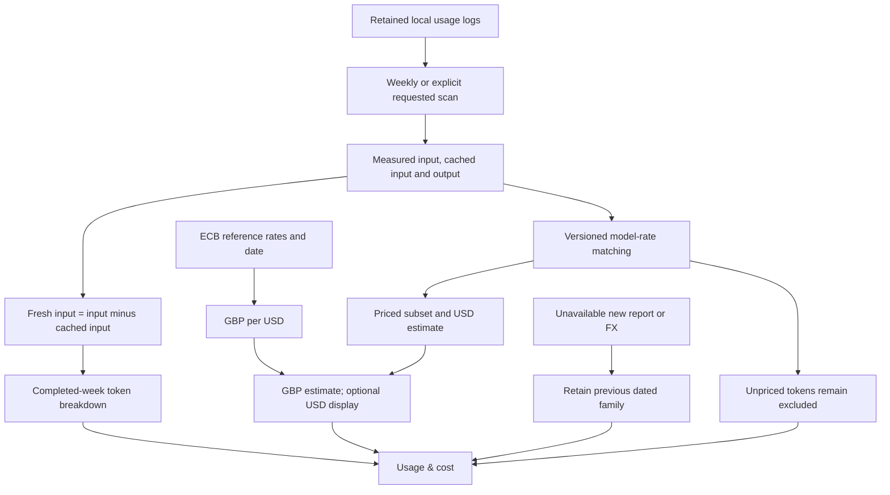
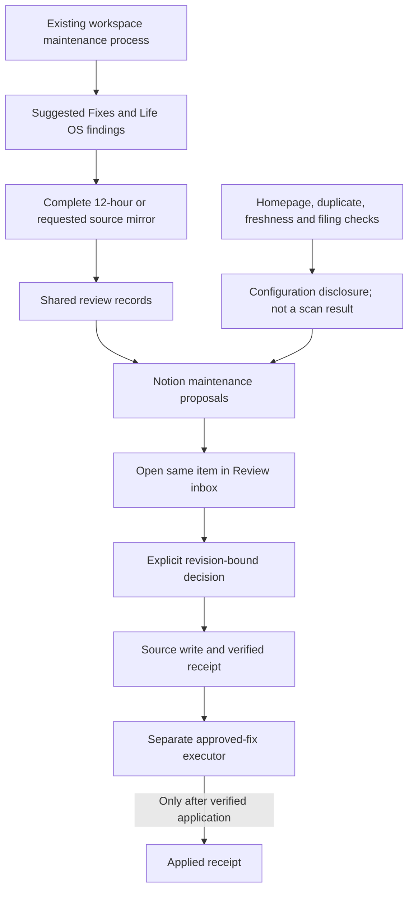
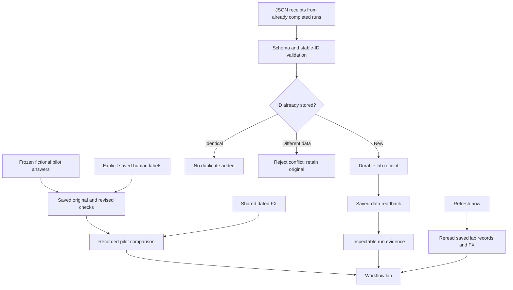

# Dashboard dataflows

These diagrams describe the private app. They omit private identifiers, credentials and personal records. Arrows show reads or explicit writes; a decision does not imply its proposed fix was executed.

## Overall

## Overview

## Review inbox

## Activity & effort

## Usage & cost

## Notion maintenance

## Workflow lab

## Shared sources and refresh impact

| Requested tab | Sources requested | Other tabs that can partly update |
| --- | --- | --- |
| Overview | Reviews, tasks, saved quality/routing evidence | Review inbox, Activity & effort, Notion maintenance |
| Review inbox | Reviews and decisions | Overview, Notion maintenance |
| Activity & effort | Tasks and local usage | Overview, Usage & cost |
| Usage & cost | Local usage and FX | Activity & effort, Workflow lab |
| Notion maintenance | Reviews and decisions | Review inbox, Overview |
| Workflow lab | Saved lab records and FX | Usage & cost |

The server computes this dependency map. A selected group commits through a validated source import; unrelated usage families are preserved. A failed source keeps its previous dated snapshot and the refresh receipt names the failure. A completed receipt requires saved-data readback. Natural timer execution, restart recovery and signed-in device access require separate observed evidence.
