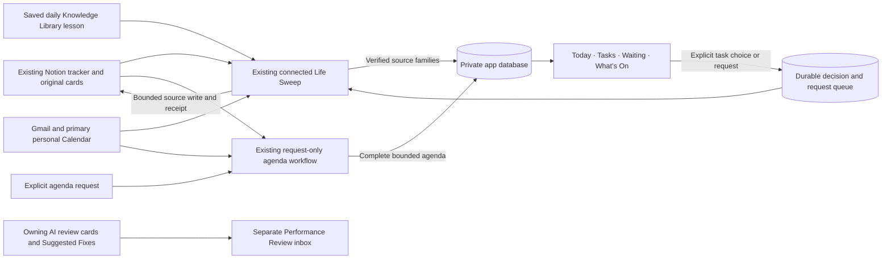
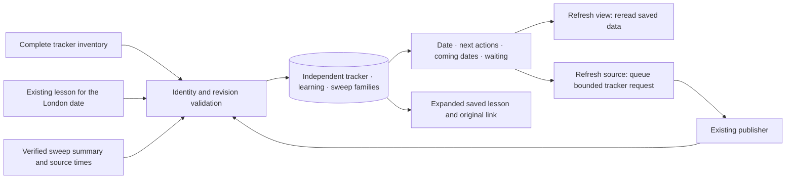
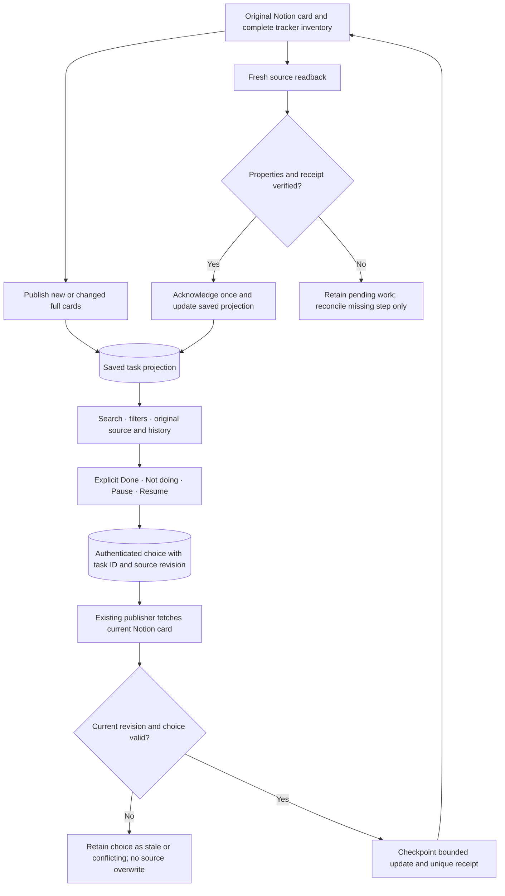
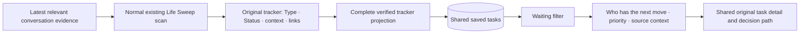
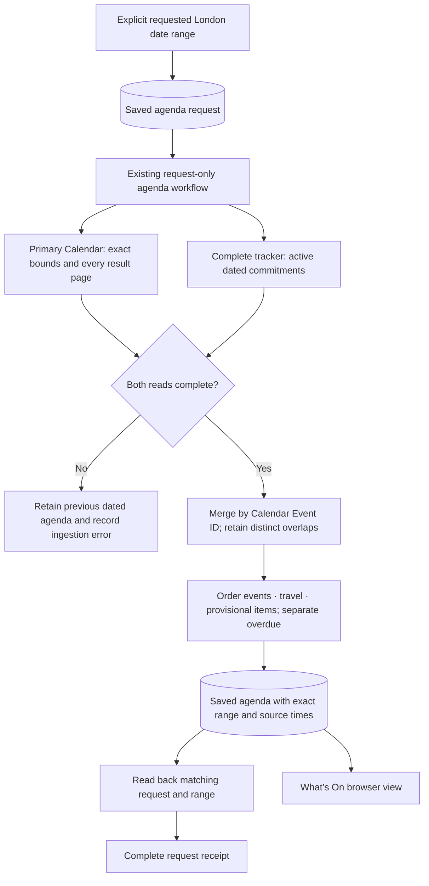

# Life OS dataflows

These diagrams explain the existing app and connected workflows. Arrows do not install a trigger or grant access. Notion remains the task store. Saved app data, fresh source reads and verified source changes are separate steps.

## Overall

Life Sweep retains its 08:00, 13:00 and 19:00 Europe/London schedule. Browser polling reads saved app data every minute while visible. A source request waits for an available connected publisher; it is not a new background scheduler. A failed source retains its previous dated family.

## Today

The lesson is reused, not regenerated by browser refresh. A source-read time is not a judgment date or evidence of phone delivery.

## Tasks and decision round trip

Reasons, original deadlines and return dates are separate. An archived record is not reopened by an expired test date. A task action never approves a suggested fix, sends mail or changes Calendar.

## Waiting

The Waiting tab reuses the same records. Opening it neither scans Gmail nor creates follow-up tasks.

## What’s On

A generated agenda is a read-only projection. It makes no Calendar, RSVP, task-status, reminder or email changes. Similar titles do not prove duplication.
