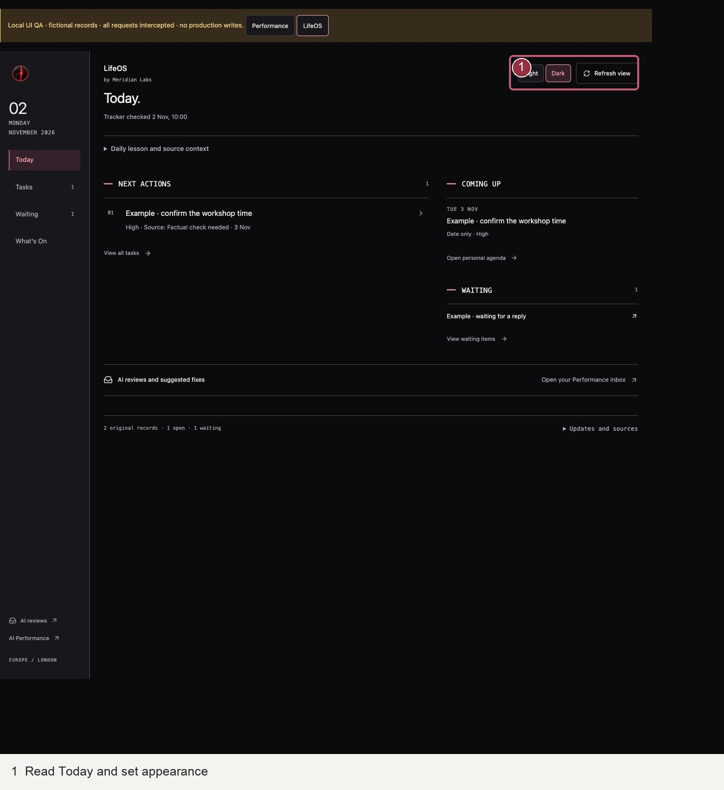
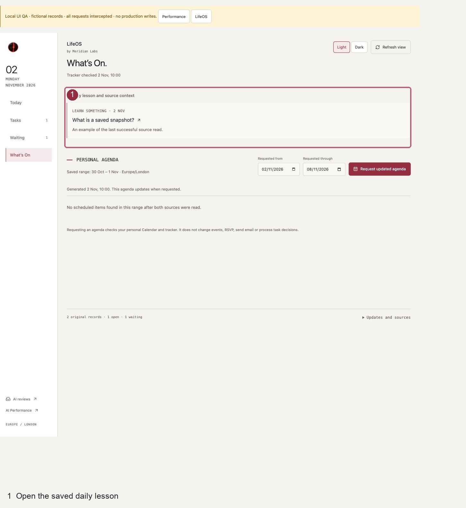
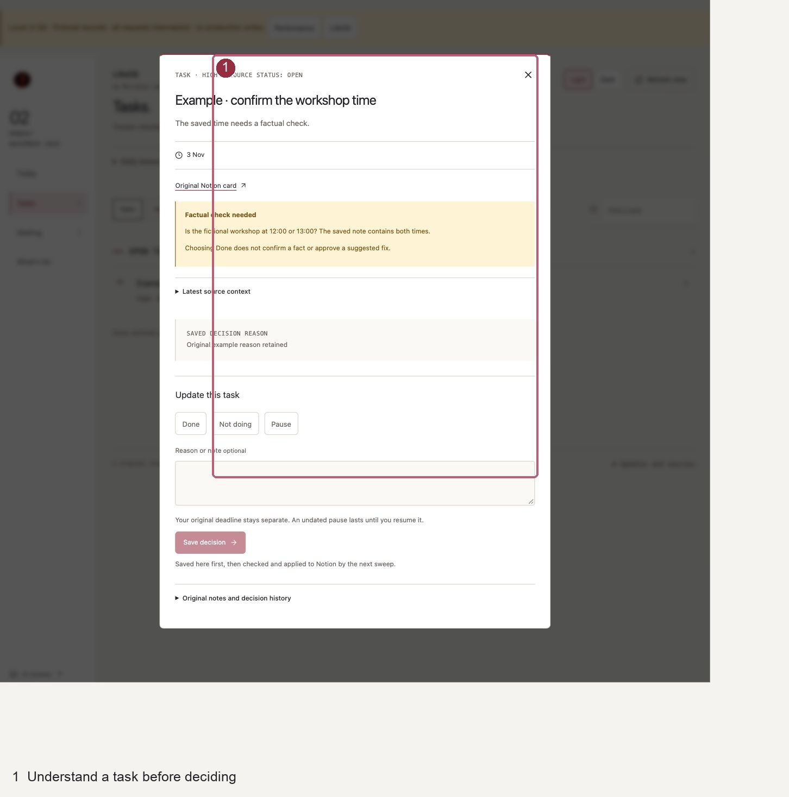
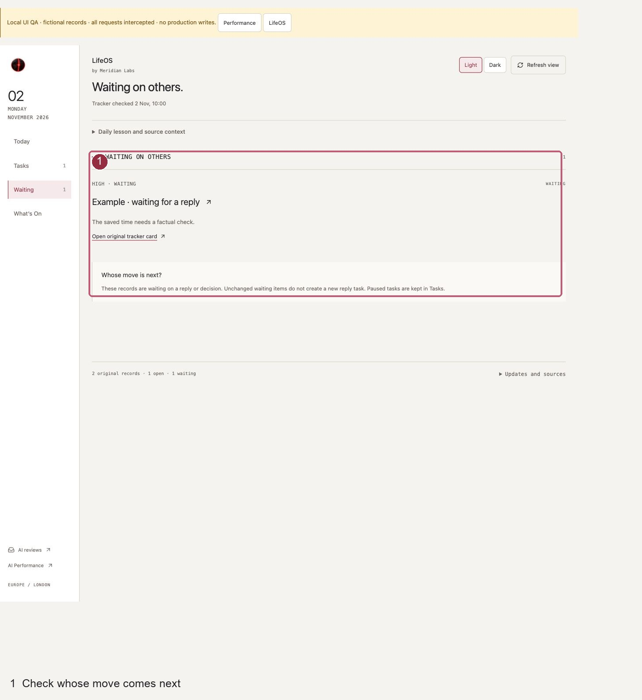
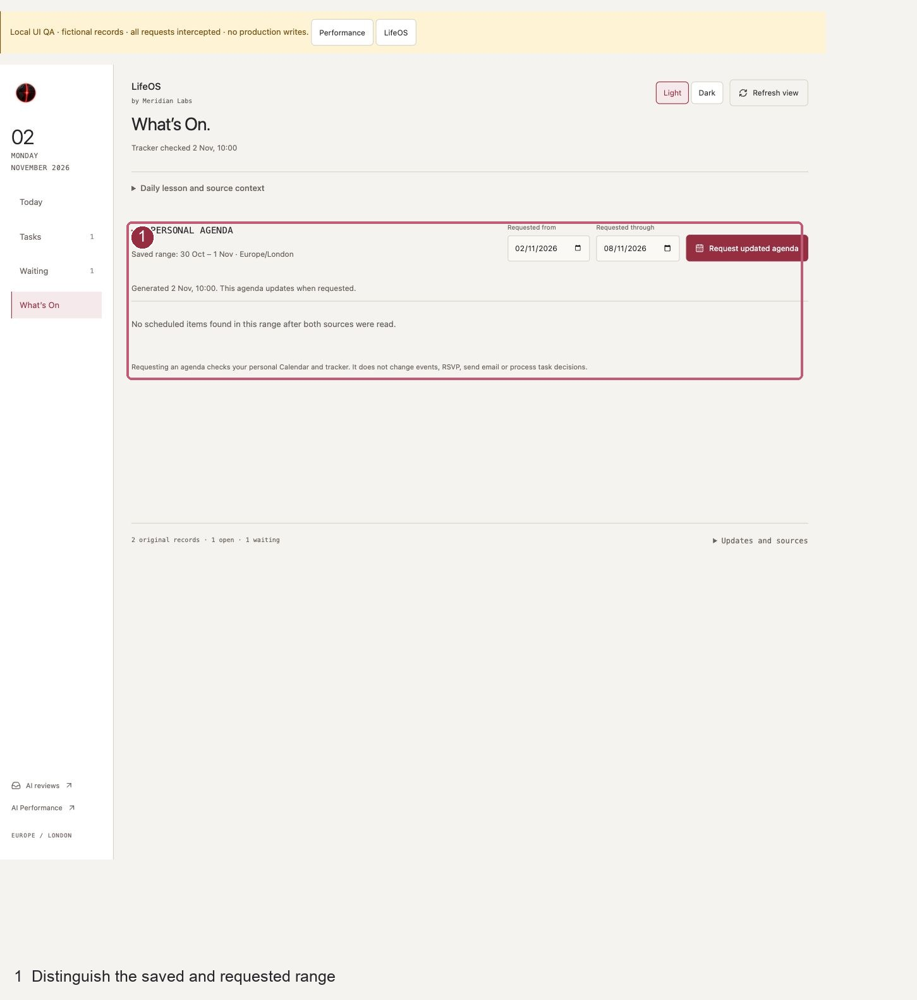
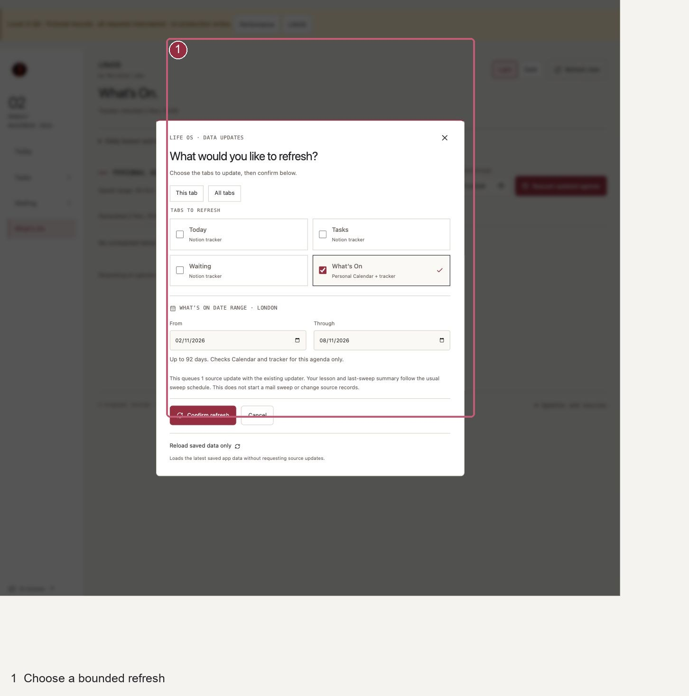
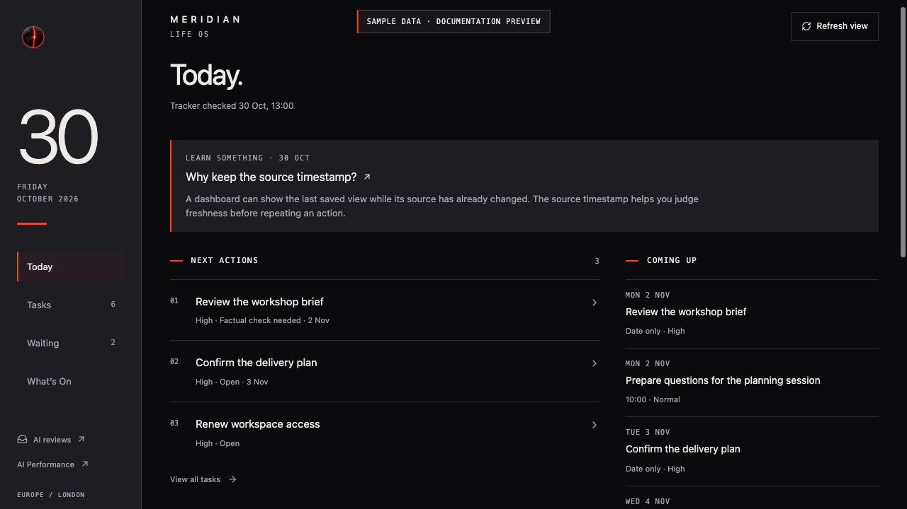
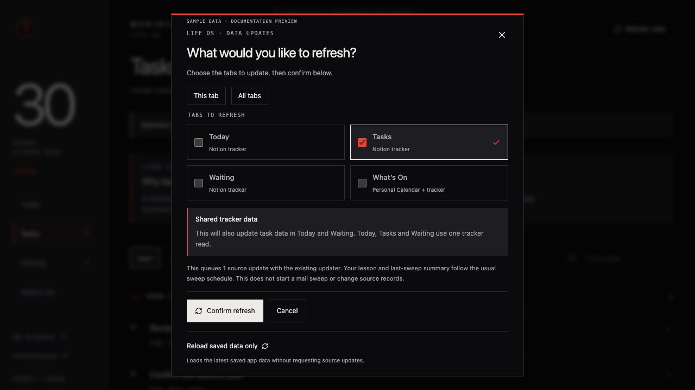
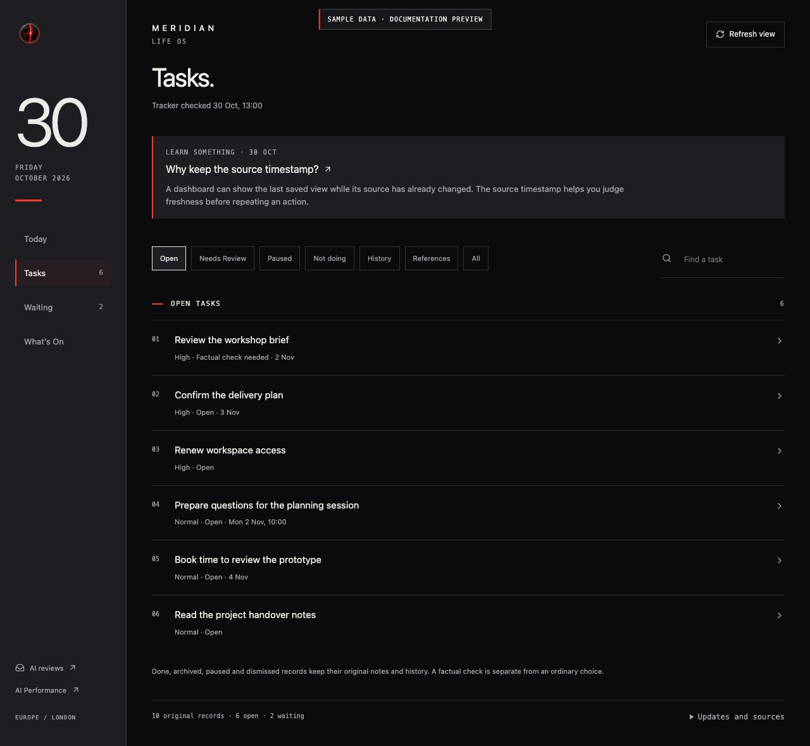
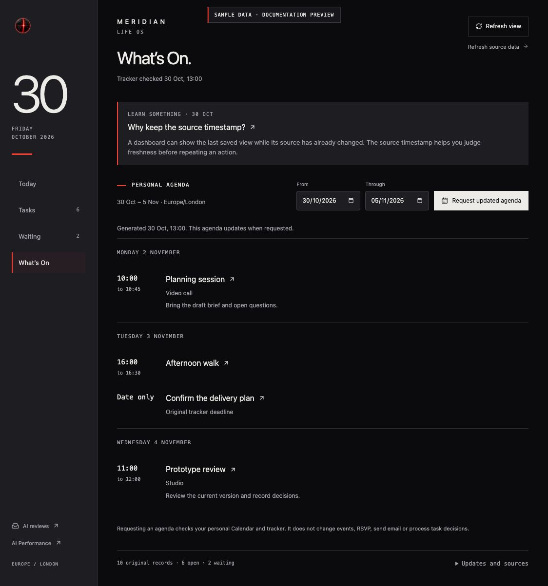

# Life OS

## Illustrated UI refresh · 2 November 2026

Implementation review edition. Saved source/build is distinct from production publication. Every screenshot uses fictional sample data; counts and dates illustrate the controls, not current account facts. The yellow QA banner belongs only to the development fixture route.

| Coverage | UI refresh edition | Publication |
| --- | --- | --- |
| life | 2 November 2026 source | Pending separate decision |

Follow this short route from the first step. Light and Dark retain the same actions and data.

### Step 1 · Read Today and set appearance

Open Life OS and Today. Read Tracker checked before relying on the list. Choose Light or Dark in the compact header; use Tasks, Waiting and What’s On for the complete views.

**Expected result and background:** The app reads its saved projection. Opening it does not run a sweep. Theme changes display only and shares the Performance preference.

### Step 2 · Open the saved daily lesson

Expand Daily lesson and source context below the header on any tab. Read the saved date, exact question and summary; open the original lesson link if useful.

**Expected result and background:** This reuses the existing saved daily entry. It does not generate a new lesson or alter the sweep schedule.

### Step 3 · Understand a task before deciding

In Tasks, use the status filter and search, then open a task. Read its exact factual question and source context. Choose Done, Not doing or Pause, add the appropriate note/return date, then Save decision.

**Expected result and background:** A saved choice is separate from the source state and sync receipt. Done does not confirm a disputed fact or approve a suggested fix. Original deadlines and decision history are retained.

### Step 4 · Check whose move comes next

Open Waiting and select the original item for its source and decision history. Use Open original tracker card when the saved context needs checking.

**Expected result and background:** Waiting remains a source state. The refresh adds no automatic reply task or completion reconciliation. Those functional changes remain in the existing feedback backlog.

### Step 5 · Distinguish the saved and requested range

Open What’s On. Read Saved range first, then enter Requested from and Requested through. Choose Request updated agenda only when you want that bounded source update.

**Expected result and background:** The previous saved agenda remains visible while a request waits. Personal Calendar and tracker are read for the requested range; opening the tab does not regenerate it or change events.

### Step 6 · Choose a bounded refresh

Choose Refresh view. This tab starts selected. Choose the tabs and agenda range, review shared-source effects, then Confirm refresh. Reload saved data only rereads the snapshot; Cancel or Escape queues nothing.

**Expected result and background:** The existing updater handles confirmed requests. Today, Tasks and Waiting share tracker data. Lesson and sweep summaries retain their normal cadence; no new mail sweep is started.

### If something looks wrong

- No matching records: clear search and status filters. A selected detail can remain visible while its queue is filtered.
- Old source date or failed update: retain the last dated result and inspect the specific failure; do not interpret it as an empty successful read.
- Saved choice still pending: read its sync state before repeating it. A saved decision is not proof its source was updated.
- Theme does not persist: storage may be unavailable. The current page remains usable; choose the mode again after reopening.
- On a phone: use Back to return from selected detail, or Close/Escape for a dialog. Physical-device delivery remains a separate check.

### Terms

**Snapshot:** the last saved source read. **Source check:** a fixed rule checked against supplied evidence. **Exact scope:** the change a named choice refers to. **Sync pending:** saved here, not yet verified in the source. **Prepared scenario:** a deterministic replay, not a new AI call.

## Retained operating reference and earlier release context

Life OS is a private Meridian web app for daily tasks, waiting items, personal dates and one saved daily lesson. It replaces the Notion dashboard page while keeping the existing Notion tracker and original records behind it. The interface offers saved Light and Dark modes and works in a desktop or mobile browser.

The four tabs are Today, Tasks, Waiting and What’s On. AI evaluations, maintenance proposals and suggested fixes stay in the separate [AI performance dashboard](ai-performance-dashboard.md) Review inbox.

These screenshots use the current interface with fictional sample data. Personal tasks, dates and source records are excluded.

## Updates and decisions

- **While open:** the app rereads its saved data every minute and when reopened. This polling does not queue source reads.
- **Source updates:** the existing Life Sweep is configured for 08:00, 13:00 and 19:00 Europe/London. It reads the original sources, updates Notion and publishes verified tracker, sweep and daily-learning data to the private app. No additional scheduler is introduced.
- **Refresh view:** opens a picker with the current tab selected. Choose this tab, several tabs or all tabs, then confirm. Today, Tasks and Waiting share one tracker read, so the picker shows which other tabs receive the same task data. What’s On queues a separate Calendar-and-tracker request for the chosen date range, up to 92 days. Selecting every tab queues at most these two source requests. They wait for the existing connected updater.
- **Reload saved data only:** a separate action inside the picker rereads the latest app snapshot without requesting a source update. Cancel or Escape also queues nothing. Lessons and sweep summaries retain the normal sweep cycle; this picker does not start a mail sweep.
- **Task choices:** Done, Not doing, Pause and Resume are saved immediately in the private app with the authenticated actor, original task ID and evidence revision. The next connected Life Sweep checks the current Notion card, records the bounded change and reads its receipt back. Saved and verified in Notion are distinct states.
- **Agenda:** generated only for an explicit requested date range. Opening the app or a routine sweep does not silently regenerate it.

The app is available from the cloud; viewing it does not require the Mac or a Terminal server. Source publication still depends on the existing connected workflow. The AI dashboard’s retained local-log collection and desktop WHOOP feed have their own Mac dependencies.

Life OS and AI Performance share one private ChatGPT Sites deployment, using Cloudflare Workers and a Cloudflare D1 app database. Hosting the interface does not move Notion records, scheduled ChatGPT work or Mac collectors into Cloudflare. The repository's public AI Workflows route remains the downloadable demo.

A natural 13:00 London run on 30 October 2026 completed in the existing cloud chat. The matching app readback showed successful tracker, sweep and learning publication. The scheduler receipt and app publication were checked separately; an explicit run-ID binding between them was not exposed. Phone notification receipt and the separate Mac desktop-feed update remain unverified. See the [dated verification](verification-life-os-2026-10-30.md).

## Today

What you see:

- The current London date and last verified tracker check.
- One expandable Daily lesson and source context section with the saved question, short explanation and original lesson link.
- A short next-actions list, coming dates and waiting items, with links to the complete lists.
- A route to AI reviews and suggested fixes in the Performance inbox.
- Source details, update requests and their actual states.

Backing data and freshness:

- Original Notion Life Sweep records, including status, priority, type, dates, factual-review flags and source links.
- The existing daily Knowledge Library lesson, reused unchanged across the day’s sweeps. App refresh does not create another lesson.
- Verified sweep metadata, with its run time separate from each source-read time.
- Published through the existing three daily sweeps or an explicit bounded source request; the browser polls the saved projection every minute.

The next-actions list is a short selection from the tracker, not a fresh AI judgment or a guarantee that every open item appears on the first screen. A past event is not automatically marked Done.

## Tasks

What you see:

- Searchable original tasks with status and priority filters.
- Open work, factual checks, pauses, dismissed items and completed or archived history.
- Task detail with the original card, source context, email/draft links where recorded, decision reason and saved history.
- Explicit Done, Not doing, Pause and Resume controls, with an optional reason and separate return date.
- Pending choices and verified source receipts.

Backing data and freshness:

- A complete inventory of the existing tracker, including inactive statuses, with full content fetched for new or changed cards.
- App decisions in a separate durable store, bound to the task’s source revision.
- Notion remains authoritative after a verified write. A pending app choice never silently overwrites a later source edit.
- The same sweep/request publication timing as Today; a choice is saved immediately but its source completion depends on the connected publisher.

Original deadlines and return dates stay separate. An undated pause lasts until explicit resumption. Archived records do not reopen because an old return date passed. Repeated or interrupted writes reconcile existing receipts instead of repeating completed actions. Task completion never approves an AI fix.

## Waiting

What you see:

- Items where another person or organisation owns the next move.
- Priority, useful dates, the existing reason/context and original source links.
- The same task detail and explicit controls used elsewhere, without making another task copy.

Backing data and freshness:

- The original tracker’s Type and Status fields and saved source evidence.
- Life Sweep establishes the latest state from complete relevant conversations during its normal source scan; a browser refresh does not scan Gmail.
- The shared tracker projection follows the existing sweep or bounded refresh timing. Source times remain visible.

A Type of Waiting and a Status of Waiting describe different aspects of the same record. A follow-up question or a newer message is not automatically a correction, new task or completed commitment.

## What’s On

What you see:

- An explicit London date range with chronological personal events and dated tracker commitments.
- Times, useful locations, all-day and multi-day entries, travel and preparation context where evidenced.
- Overlapping events and provisional tracker items, plus overdue work separately.
- Original Calendar or Notion links and the agenda’s generation/source-read dates.
- A request control for a new range and its queued, running, completed or failed state.

Backing data and freshness:

- The primary personal Google Calendar, read with exact start and exclusive end bounds and all result pages.
- The complete existing tracker, filtered to relevant active dated commitments.
- Matching Calendar Event IDs merge the same event. Similar titles alone do not merge different records or hide a conflict.
- Generated only for an explicit request by the existing connected agenda workflow. The saved agenda stays visible until a verified replacement is published.

The agenda workflow does not change Calendar, RSVP, tracker status, reminders or email. A failed required read retains the previous agenda and reports the error; it is never presented as an empty successful week. Undated work does not receive invented dates.

## Data and history

The app separates original source records, saved projections, authenticated decisions and verified receipts. Tracker, sweep, learning and agenda have independent observation and success dates. A single writer lease prevents overlapping Life OS publication. Complete inventories, source identity checks and revision checks protect imports and decisions.

Existing per-card preferences, reasons, attachments, reminder receipts and prior outcomes remain on their original Notion records. AI review handoffs keep their original choices, free-text notes and evidence revisions on their owning records. The old front pages are migration/history entry points rather than current writers. No Notion database is replaced and no column is deleted.

The app is owner-private. Source access and app access are separate: a Site publication credential grants no Notion, Gmail or Calendar permission. Personal records, private identifiers and credentials are excluded from this repository and its release assets.

[Overall and per-tab dataflow diagrams](life-os-dataflows.md) explain the source and decision paths. [The AI dashboard guide](ai-performance-dashboard.md) covers reviews, activity, usage, maintenance and the workflow lab.
