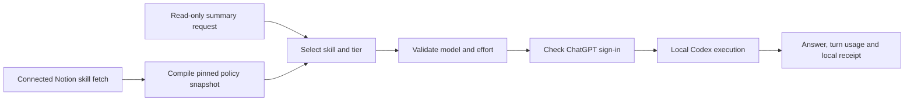

# Model routing: local subscription pilot

The four-workflow browser demo now uses this runner for automatic output reviews. See the [demo setup](showcase.md) and [dated verification](verification-2026-10-26.md). The pilot below describes the underlying subscription execution boundary.

## What works

The new direct-first planner and thin prompt-hook helper are documented in [Cross-device operation](cross-device-operation.md). They separate appropriate direct execution from verified delegation; neither installs universal ChatGPT interception.

A connected Notion fetch can now be compiled into a versioned local policy. The summary pilot reads the Active skill's three Model Choice properties, version and body effort table. It selects the Low route and runs a bounded, read-only text task through the installed Codex CLI using an existing ChatGPT sign-in. No API key is required or used.



The connector fetch happens in the coordinating session. This is not a background Notion synchroniser: export the latest fetched page when refreshing configuration. The standalone CLI does not hold Notion credentials or pull changes itself. The first mapping uses the `summarisation` internal alias for the source skill's Extract/summarise mode; the snapshot retains its real name and version. This is a narrow integration, not an import of every Active skill.

## Run boundaries

The default route-preview command remains entirely offline:

```bash
python3 -m workflow_portfolio.routing --policy examples/routing/policy.json --capabilities examples/routing/capabilities.json --request examples/routing/request.json
```

To compile a connector's parsed fetch response, use an ignored local directory:

```bash
python3 -m workflow_portfolio.routing.notion_config --export private-data/notion-export.json --output private-data/policy.json
```

After obtaining current supported model/effort capabilities from the installed CLI, the explicit live command is:

```bash
python3 -m workflow_portfolio.routing.local_codex --policy private-data/policy.json --capabilities private-data/capabilities.json --request private-data/request.json --receipt private-data/unique-task-receipt.json
```

This last command consumes subscription allowance. It checks ChatGPT login, removes API-key and endpoint environment overrides, ignores user provider configuration, explicitly requires ChatGPT authentication and requests the selected model/effort. It runs in a temporary read-only workspace. It does not change the model in the calling chat. Never put API secrets, source exports, answers or live receipts in Git. Example capability files are synthetic; catalog presence alone is not entitlement evidence.

The caller must supply an explicitly read-only task and a stable receipt path per goal. An exclusive claim prevents repeating that receipt after completion or uncertain failure. Different receipt paths represent new executions: this is not global cross-session deduplication. There is no automatic retry, escalation, paid fallback, scheduled execution or business writer. The pure retry planner remains separate and does not enable live retries.

## Verification evidence

The local test on 23 October 2026 compiled the current Notion summary route into Luna/Low and completed one synthetic summary correctly. It retained all three facts, including that the scheduled test had not run.

The successful CLI turn reported 13,680 input tokens, including 11,520 cached input tokens, and 22 output tokens. Total processed tokens were 13,702; cached input is a subset, not an extra 11,520. This measures the test invocation, not coordinator overhead or whole-workflow savings. No token-cost estimate was assigned without a matching real rate card.

The initial sandboxed launch failed; the later explicitly authorised local launch succeeded. Both attempt receipts are retained outside Git. Do not turn a failed/uncertain receipt into a new model call without diagnosis.

The runner records requested settings, accepted execution, answer and raw turn usage. Independent backend model/effort are not exposed by the exec event stream and remain unknown. Successful dispatch is not proof of a separate backend identity field.

## Still outside this pilot

- Ordinary Chat, cloud Work, mobile and existing scheduled jobs are not intercepted. Only requests explicitly sent through this runner are controlled.
- Ambiguous tasks need a classifier adapter or an explicit choice; the classifier boundary is tested, but no live classifier is installed.
- Other skill modes, inherited model resolution, policy freshness automation, dashboard upload and whole-task coordinator/worker accounting remain separate integrations.
- A production allowance cap needs provider-supported enforcement; this pilot limits calls to one and stops on failure, not a guaranteed token ceiling.

Notion remains the policy source. Local snapshots are operational inputs, not competing model lists. `Inherit current` fails without an evidenced runtime context; `Not applicable` disables a tier. Missing or incompatible configuration never silently substitutes a model.

Official runtime reference: [Codex non-interactive mode](https://learn.chatgpt.com/docs/non-interactive-mode).


## Five-workflow recorded demo · 28 October 2026

The new [demo routing and cost layer](showcase-routing-and-costs.md) reuses `select_route` and the domain preflight checks. It implements explicit evidence-based model/code/hold rules across all five workflows and an inspectable policy preview. The scenario UI can select a matching recorded guided answer. This policy was defined after the 40 fixed-configuration calls, so it is exploratory replay, not a claim those original calls were automatically routed. No new inference, classifier or retry is enabled.
