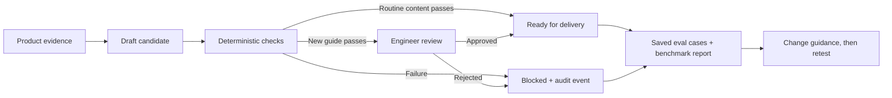

# Release workflow engineering

I built this independent, runnable example to show how I approach an AI workflow from source evidence through quality checks, review and evaluation. A draft release note can sound convincing while promising a feature to people who cannot use it. This first slice catches that error and records the decision. It is the starting point for a larger, source-shaped portfolio build, not the whole release workflow. [The portfolio map](../docs/portfolio-map.md) shows the original system's structure, what this repo currently proves, and what comes next.

**Everything in the examples is synthetic.** This is a new portfolio implementation. It does not contain or connect to an employer's systems, source code, customer data or credentials.

## Scope and entry points

For the four-workflow overview, follow the [workflow tour](portfolio-tour.md). This page covers the older release service, candidate relay and n8n examples. The browser showcase is a separate local execution surface with optional routed model review and a durable private local release feed. Its [verification record](verification-2026-10-26.md) covers routine automation and the new-feature/new-document review gates.

For the product-change report example, follow the [release journey](release-journey.md). Its two offline commands use the same fictional report for a relay preview and code-only draft checks. Shared input does not make the stages a hosted, connected publishing system.

| What to inspect | Where |
| --- | --- |
| Source facts, draft claims and the rules that compare them | [`domain.py`](../src/workflow_portfolio/domain.py) |
| Block, review and ready-for-delivery decisions | [`service.py`](../src/workflow_portfolio/service.py) |
| One record per change and an audit trail | [`store.py`](../src/workflow_portfolio/store.py) |
| Matched-case model comparison | [`evals.py`](../src/workflow_portfolio/evals.py) |
| The same audience check on an n8n canvas | [Importable workflow](../exports/n8n/release-note-review.json), [reviewable source](../.n8n/release-note-review/workflow.json) and [n8n tour](../docs/n8n.md) |
| A source-shaped release candidate relay | [n8n workflow](../.n8n/release-candidate-relay/workflow.json), [code-only preview](../scripts/preview-candidates.mjs) and [walkthrough](../docs/release-candidate-relay.md) |
| A candidate decision and safe retry | [n8n callback parser](../.n8n/candidate-review-callback/workflow.json), [local decision store](../src/workflow_portfolio/candidate_review.py) and [walkthrough](../docs/candidate-review.md) |
| A product report followed by wrong and corrected release notes | [Shared fictional case](../examples/release_journey.json), [code-only journey](../src/workflow_portfolio/journey.py) and [walkthrough](../docs/release-journey.md) |
| Optional OpenAI structured drafting | [Adapter](../src/workflow_portfolio/openai_adapter.py), [source-backed skill](workflow-guidance/release-note-drafting.md) and [run guide](../docs/openai-drafting.md) |
| Public-safe task guidance | [Release-note skill](workflow-guidance/release-note-drafting.md) and [knowledge-gap skill](workflow-guidance/knowledge-gap-triage.md) |
| Release test definitions | [`tests/test_workflow.py`](../tests/test_workflow.py) |

The repo currently has **two inspectable versions of one audience check**: an offline Python service and an inactive n8n workflow with its Code nodes in separate files. The Python version also has persistence, idempotency, review transitions and matched-case evaluation. A second, [source-shaped relay](../docs/release-candidate-relay.md) accepts a fictional change report, groups PRs, skips repeated candidates and prepares a review card. An inactive [callback parser](../docs/candidate-review.md) shows the review command; a separate local store saves it and handles retries. A [manual GitHub Action](../.github/workflows/code-only-review.yml) runs saved examples without n8n or external writes. The n8n canvases do not yet carry the full release journey. [Opt-in n8n tools](../docs/n8n-deployment.md) can preview deployment and read one workflow into a Git-ignored local folder; neither has been tried against n8n Cloud. There is no nightly GitHub mirror yet. An [optional OpenAI drafting adapter](../docs/openai-drafting.md) is implemented and fake-tested; this separate drafting adapter has no verified live call. The offline build does not read a customer's tenant or publish content. [The portfolio map](../docs/portfolio-map.md) explains how the complete n8n and GitHub-only paths will fit together.

## Why this example

An AI draft can read well and still tell the wrong customers that a feature is available. The example uses a beta CSV export release note. The source says it is enabled for a pilot cohort; the bad draft says all customers can use it. The workflow blocks that mismatch before publication, records why, and keeps the source and draft together for review. This is one narrow workflow inside the broader pattern of source-backed agents, evaluation, review, and improvement.



## Run it

Requires Python 3.9 or newer. No network access or third-party packages are needed.

```bash
python3 -m workflow_portfolio demo
python3 -m workflow_portfolio benchmark
python3 -m workflow_portfolio journey examples/release_journey.json
python3 -m unittest discover -s tests -v
```

`demo` creates a temporary SQLite database, processes three fictional candidates, and prints the resulting decisions and audit trail. `benchmark` scores two fictional model outputs against the **same** saved cases. Neither command calls a model or publishes anything externally. **Ready for delivery is a decision state, not proof of publication.**

To inspect one candidate:

```bash
python3 -m workflow_portfolio submit examples/beta_csv_bad.json --db /tmp/meridian-labs-demo.sqlite3
python3 -m workflow_portfolio report --db /tmp/meridian-labs-demo.sqlite3
```

The CLI imports from `src/` through a small local launcher. For normal package installation, run `python3 -m pip install -e .` in a virtual environment.

To inspect the n8n version, open [the generated workflow export](../exports/n8n/release-note-review.json) or import it into a separate test workspace. With Node 24 or newer, `npm run n8n:build` rebuilds that export from the [reviewable workflow source](../.n8n/release-note-review/workflow.json) and [Code-node files](../.n8n/release-note-review/code/), and `npm run n8n:check && npm run test:n8n` verifies it. The workflow is inactive and its outputs stay within the run.

## What it demonstrates

- **Source-backed generation boundary:** product evidence and draft output are separate typed inputs. The model can be swapped without changing the publication rules.
- **Access and quality controls:** the audience in a draft must match the confirmed rollout scope, required source links must be present, and the change must have a stable source ID.
- **Idempotency:** a stable change ID keeps one record when another PR joins a feature. A separate PR-link index rejects attempts to attach the same PR to another change.
- **Selective review:** the trusted source, not the generated draft, defines whether content is a new guide. Routine content can become ready for delivery after checks; a brand-new guide requires an engineer decision. Every transition is auditable.
- **Evaluation and benchmarking:** saved examples require every candidate model to answer the same cases, show each failure by case and report token coverage. Missing usage stays unknown. The benchmark data is illustrative.
- **Failure handling:** malformed inputs fail closed, SQLite writes are transactional, and error messages do not print input payloads.

## Boundaries before a real deployment

This repository is a **shareable reference implementation**, not a live service. A deployment would need authenticated adapters for GitHub, the content store and notifications; a real model client; rate limits and retries; tenant-scoped authorization at every read and write; operational monitoring; and a reviewed data-retention policy. The deterministic checks are only one part of quality: a human or separately validated evaluator still needs to judge clarity and factual usefulness.

See [architecture.md](../docs/architecture.md) for the decision path, [rebuild-plan.md](../docs/rebuild-plan.md) for the next implementation stages, and [security.md](../docs/security.md) for the release checklist.
