# Meridian Labs · AI Workflows

## Illustrated UI refresh · 2 November 2026

Implementation review edition. Saved source/build is distinct from production publication. Every screenshot uses fictional sample data; counts and dates illustrate the controls, not current account facts. The yellow QA banner belongs only to the development fixture route.

| Coverage | UI refresh edition | Publication |
| --- | --- | --- |
| workflows | 2 November 2026 source | Pending separate decision |

Follow this short route from the first step. Light and Dark retain the same actions and data.

### Step 1 · Choose a workflow

Open Workflows, then choose Open workflow on the task you want. Use Appearance to choose Light or Dark.

**Expected result and background:** The directory opens a prepared, fictional scenario. Changing appearance saves a browser preference; it does not change a result.

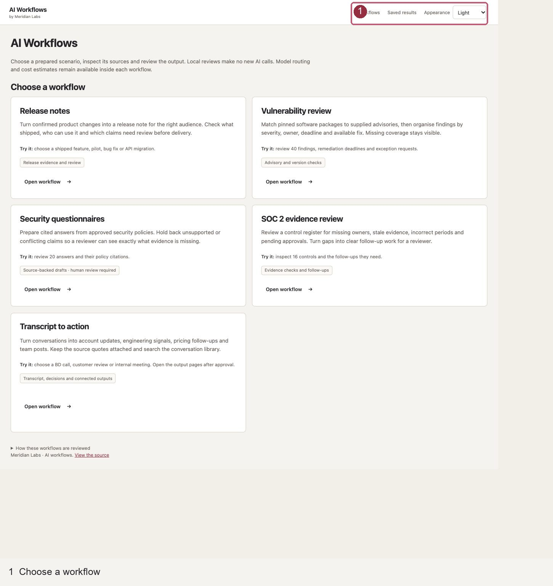

### Step 2 · Inspect the route before reviewing

Choose a Scenario. Open Model route & cost for its plan, or Adjust route & token budgets for the editor. Cancel leaves the selected plan unchanged; Use this route applies the displayed assumptions.

**Expected result and background:** The calculator retains the existing models, efforts, rates and token calculations. A route estimate is not a new model run or measured saving.

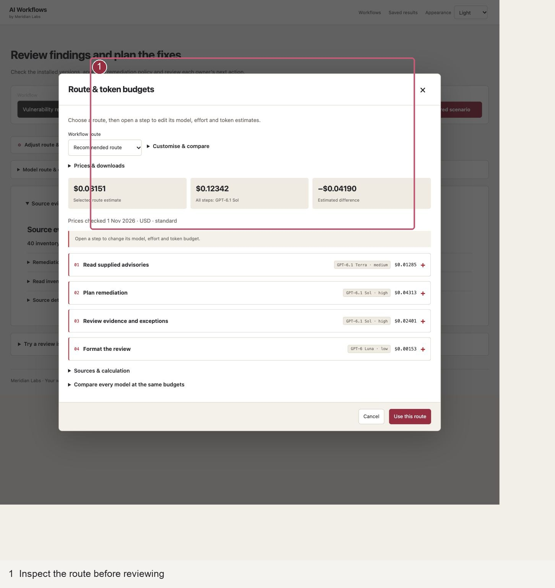

### Step 3 · Review the finding that matters

Click Review prepared scenario. In Output, use Find a record and Source status, then select a row. Installed version, original deadline, owner and closure evidence stay with that record.

**Expected result and background:** The same 40 supplied findings and deterministic checks are used. Search changes the visible queue; selecting a row does not approve it. On phones, Back to records retains the filters.

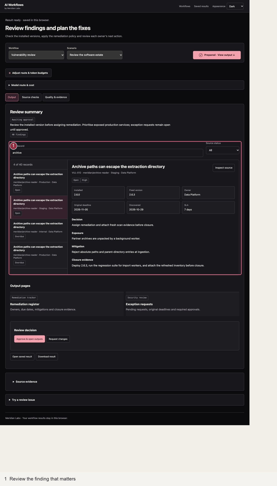

### Step 4 · Read the supporting evidence

Choose Inspect source beside the selected finding. Read its inventory and advisory excerpt. Use Close evidence or Escape to return to the same control.

**Expected result and background:** The inspector displays the existing source excerpt. It does not retrieve fresh external evidence or modify the inventory.

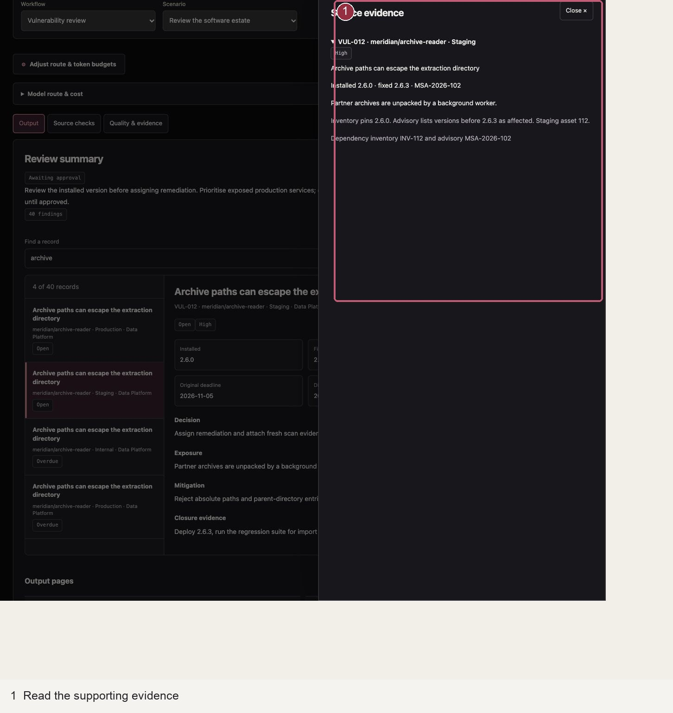

### Step 5 · Separate checks from judgment

Choose Source checks. Read each Passed or Flagged rule and its View source link. Open Quality & evidence separately for recorded-answer comparisons where matching evidence exists.

**Expected result and background:** Fixed checks, original model answers and reviewer judgment remain separate. Missing matching answers do not become a score.

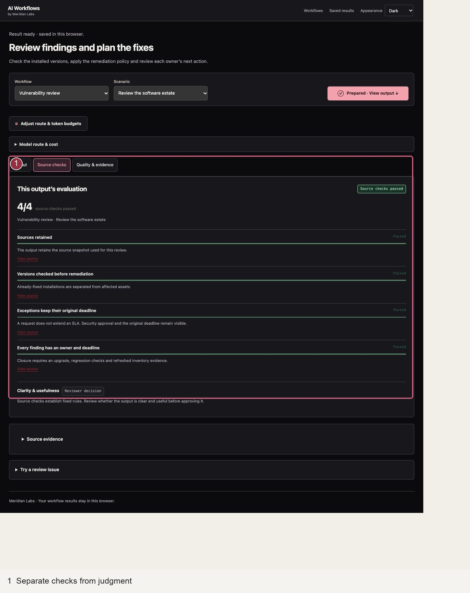

### Step 6 · Review a cited questionnaire answer

Choose Security questionnaires, then Review prepared scenario. Select an answer and inspect its supporting policy. Retain Qualified and Needs evidence responses.

**Expected result and background:** The existing 20 questions and 12 policy sources supply the answers. Approval does not send the response to a customer.

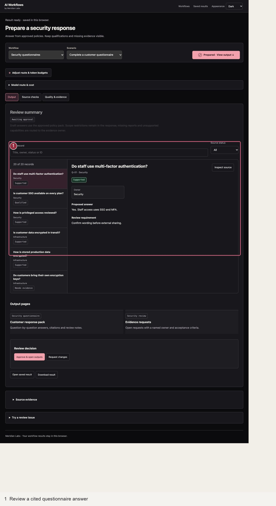

### Step 7 · Check a control and its period

Choose SOC 2 evidence review and Review prepared scenario. Select a control. Compare Required period, Evidence period, owner and review note before accepting the pack.

**Expected result and background:** The existing 16 controls retain stale, wrong-period, missing-owner and pending-approval states. A newer layout does not resolve those gaps.

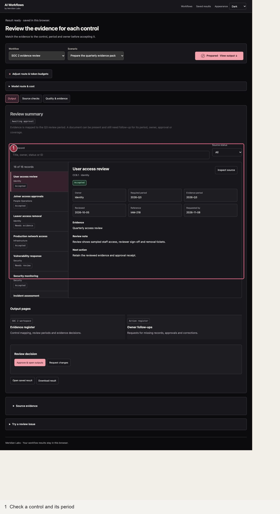

### Step 8 · Switch between connected destinations

Choose Transcript to action and Review prepared scenario. Use Account updates, Engineering signals, Pricing follow-ups, Meeting report and Transcript knowledge to inspect each branch.

**Expected result and background:** All five existing destinations remain available. Indicative budget is distinct from approval; a reported issue is distinct from a verified diagnosis. Source quotes remain linked.

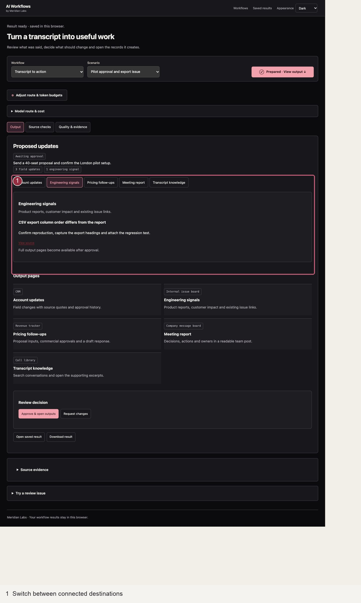

### Step 9 · Review the announcement as a draft

Choose Release notes and a scenario, then Review prepared scenario. Start in Draft; open Source checks and Quality & evidence when needed. Review rollout conditions before Approve & publish.

**Expected result and background:** This approval opens a sample release-note page in browser storage. It does not publish a real release or change external product availability.

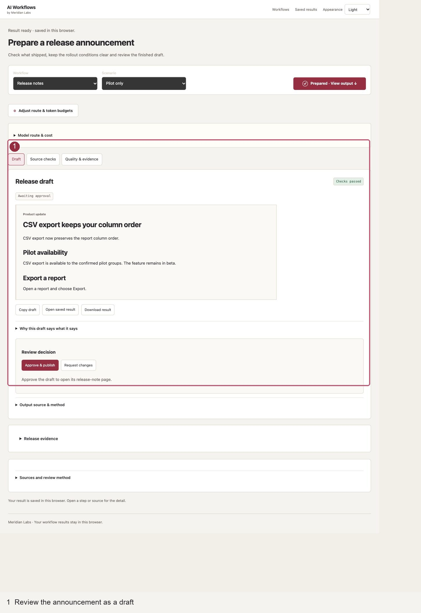

### Step 10 · Resolve a failed check

In Try a review issue, choose Load an issue for review. Open Source checks to read the flagged deadline rule. Return to Output, choose Request changes, then Review revised draft for the supported correction.

**Expected result and background:** Failed checks disable approval. Supported revisions retain before/after evidence; arbitrary notes remain feedback rather than an invented rewrite.

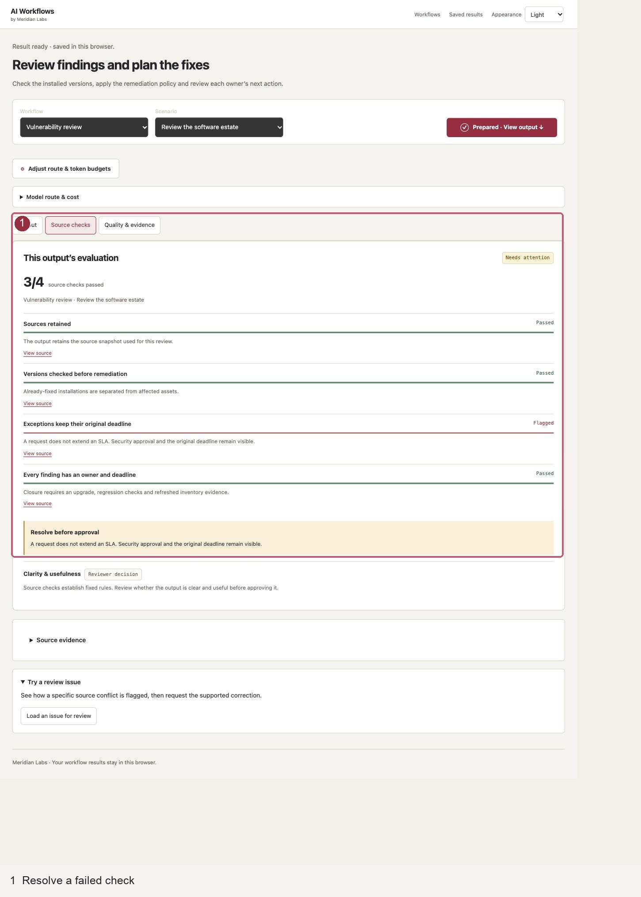

### Step 11 · Open approved outputs and return later

After reviewing a valid draft, choose Approve & open outputs, then a destination such as Remediation register. Back to review returns to its saved evidence. Saved results in the header reopens browser-local history.

**Expected result and background:** Existing approval and publication payloads are unchanged. Results belong to this browser and origin. Download result preserves a JSON copy; no external business system is written.

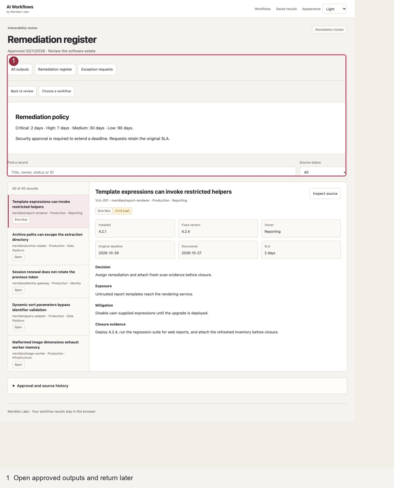

### If something looks wrong

- No matching records: clear search and status filters. A selected detail can remain visible while its queue is filtered.
- Old source date or failed update: retain the last dated result and inspect the specific failure; do not interpret it as an empty successful read.
- Saved choice still pending: read its sync state before repeating it. A saved decision is not proof its source was updated.
- Theme does not persist: storage may be unavailable. The current page remains usable; choose the mode again after reopening.
- On a phone: use Back to return from selected detail, or Close/Escape for a dialog. Physical-device delivery remains a separate check.

### Terms

**Snapshot:** the last saved source read. **Source check:** a fixed rule checked against supplied evidence. **Exact scope:** the change a named choice refers to. **Sync pending:** saved here, not yet verified in the source. **Prepared scenario:** a deterministic replay, not a new AI call.


## Retained operating reference and earlier release context


Explore the workflow routes, compare model choices and review saved answers. This is AI Workflows v1.2.1, with the same routes and interface as the hosted demo. This package is a small runnable part of the [full GitHub repository](https://github.com/olilifts88/meridian-labs).

## Choose how to use it

### Open online

[Open Meridian Labs AI Workflows](https://meridian-ai-workflows-oli.misty-moon-5776.chatgpt.site/) in your browser, choose a workflow and click **Run workflow**. No download, Python or installation is needed for the public site.

### Run the download locally

The download remains available if you prefer a local copy.

1. Unzip `meridian-ai-workflows.zip`.
2. Open the extracted `meridian-workflow-showcase` folder, then open a terminal in that folder. See [Setup help](#setup-help) below if this is new to you.
3. Start the demo:

   **Mac / Linux**

   ```sh
   python3 showcase_demo.py
   ```

   **Windows**

   ```powershell
   py showcase_demo.py
   ```

4. Open **http://127.0.0.1:8766** in your browser. Leave the terminal open while using it. Press Ctrl+C there to stop.

Requires **Python 3.9 or newer** and a modern desktop browser. No packages to install, Node, AI sign-in, API key or paid service are needed for these paths. If port 8766 is busy, run `python3 showcase_demo.py --port 8768`, then open http://127.0.0.1:8768. Python must already be installed; this ZIP is not an installer or mobile app.

## What to click

- **Workflows:** choose a task, inspect the source evidence and click **Run workflow**.
- **Adjust route & token budgets:** change the model route or per-step assumptions before running. The comparison names the one-model alternative and shows the signed cost difference.
- **Output evaluation:** after Run workflow, the source checks and artefact appear automatically. Matching recorded model answers are expandable where available. A brief reveal respects reduced-motion preferences.
- **Review decision:** inspect the checks, approve the output pages or request a supported revision. A written note alone is saved as feedback; it does not generate an arbitrary rewrite.
- **Output pages:** release notes open a branded product update. Transcript to action opens CRM, an issue board, a revenue tracker, a team post and a searchable call library. Other workflows open their registers and follow-ups.
- **Saved results:** return to the route, sources, decisions and approved pages stored in this browser.

Try four release examples, four transcript scenarios, 40 vulnerability findings, 20 security questions and 16 SOC 2 controls. Source details link to the supporting evidence and review method.

The calculator supports GPT-6 Luna, GPT-6 Sol, GPT-6.1 Sol, GPT-6.1 Terra and GPT-6 Astra. It handles cached reads and writes, processing tiers, context length, region and retry budgets. [How model routing and costs work](workflow-stage-routing.md).

## Pricing checks

The launcher checks OpenAI's public documentation before opening the demo. A scenario save also checks prices. If the web check fails, the last verified rate card is retained. Sources & calculation shows its date and basis.

To start without a web check, use `python3 showcase_demo.py --offline` (or `py showcase_demo.py --offline` on Windows). No model calls or API keys are needed. The hosted version uses the same calculator and a server-side pricing check.

## Source answers and scenario routes

The original forty AI answers and evaluation records remain available as supporting evidence. New prepared business outputs are separate from that benchmark. Choosing a different stage route changes the plan and cost estimate; it does not generate a new AI answer or alter a review. Quality evidence stays linked to the answer and setup it assessed. Costs are token estimates, separate from tool fees and subscription charges.

Workflow decisions operate on sample business data. Approval does not update an external CRM or send a message. Missing evidence and failed checks still hold the relevant action.

## Where your results are saved

Visitor results use the browser's local storage for the address you opened. The public site and a localhost copy have separate histories, as do different browsers or ports. Private-browser results belong to that private session and may be removed when it closes. They are not uploaded or written to the repo's model results. Clearing browser data removes them, so download JSON results you want to keep. Up to 50 results are retained; nothing is silently evicted. If saving is unavailable or storage is full, you can still download the completed result.

The launcher serves only the bundled public demo and the pricing check. It has no owner-review write endpoint. Owner review labels shown in the recorded library are a snapshot; private review comments and raw execution receipts are not included.

## Inspect the code and method

- [Source snapshot and scenario runner](../src/workflow_portfolio/recorded_showcase.py): real recorded answers, receipt provenance, re-evaluation and approval gates.
- [Current browser interface](../demo-web/assets/run-explorer.mjs): workflow navigation and saved results.
- [Business scenario sources](../demo-web/assets/business-data.mjs): prepared records and source-linked outputs.
- [Local browser server](../src/workflow_portfolio/web_demo.py): loopback assets and pricing checks.
- [Routing and estimated costs](../src/workflow_portfolio/showcase_measurement.py): versioned rules and an adapter to the reusable token calculator.
- [Visitor storage](../src/workflow_portfolio/visitor_results.mjs): browser-owned results, validation and downloads.
- [Domain evaluators](../src/workflow_portfolio/showcase_assurance.py) and [call/CRM engine](../src/workflow_portfolio/call_crm.py): workflow rules and evidence/approval checks.
- [Experiment and checker revisions](../src/workflow_portfolio/ai_pilot.py): frozen cases, original checks and separate recheck. Its model adapter is included for code inspection; this launcher does not use it to generate answers.
- [Recorded-versus-scenario guide](recorded-workflows.md): scope, safeguards and current limits.

The full repository contains the wider implementation, tests and supporting guides. This ZIP includes only the demo's required source, examples, browser assets and instructions. The [public hosted demo](https://meridian-ai-workflows-oli.misty-moon-5776.chatgpt.site/) is available as an alternative; no hosting account is needed to use this download.


## Setup help

**Opening a terminal in the right folder**

- **Windows:** open the extracted folder in File Explorer. Click its address bar, type `powershell`, and press Enter. Run `py showcase_demo.py` in the window that opens.
- **Mac:** open Terminal. Type `cd ` with a space after it, drag the extracted folder from Finder into Terminal, then press Return. Run `python3 showcase_demo.py`.
- **Linux:** open the extracted folder in your file manager and choose **Open in Terminal**, if available. Run `python3 showcase_demo.py`.

**Python is missing or too old**

Check with `python3 --version` on Mac/Linux or `py --version` on Windows. You need Python 3.9 or newer. Install it from [python.org](https://www.python.org/downloads/), reopen the terminal, and try again. There is no separate package-install step.

**“Can't open file” or “No such file”**

Make sure the ZIP is extracted and you are in the folder containing `showcase_demo.py` and this README. Do not run the file from inside a ZIP preview or copy only the launcher out of its folder.

**The address is already in use**

Another copy may already be running. Use its existing browser address, stop it with Ctrl+C, or start on another port:

```sh
python3 showcase_demo.py --port 8768
```

On Windows, replace `python3` with `py`. Then open **http://127.0.0.1:8768**. A different port has separate browser history.

**The browser page will not open**

Keep the terminal running and use the exact address printed there. This is a local desktop app: opening the address on another device will not connect to it.

Transcript to action branches into five destination paths, each with its own model, effort and token budget. Click a path for its proposed records, source excerpts and checks. The paths join for shared review before output formatting. The calculator includes every branch, the shared steps and any retry budget.
