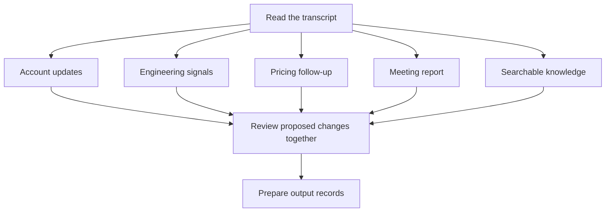

# Workflow model routing and cost estimates

A route assigns a model, effort level and token budget to each part of a workflow. The recommendation puts more review capacity into decisions that could change a claim, commitment or business record, and uses a lower-cost model to format the reviewed output.

The [public site](https://meridian-ai-workflows-oli.misty-moon-5776.chatgpt.site/) and local download offer the same route controls and completed artefacts. They use saved answers and prepared business outputs. Changing a route recalculates its budget without making a new model call.

## How the route is chosen

The selected workflow supplies a predefined stage plan. Its scenario supplies the evidence, output and approval checks. The router does not search every possible combination or select a winner automatically.

1. **Validate the evidence.** Code handles fixed rules such as source matching, installed-version checks and duplicate records.
2. **Assign the work.** Each stage has a default model and effort based on the judgment it needs. Visitors can keep the recommendation, choose a preset or edit individual stages.
3. **Apply evidence and approval gates.** Model choices cannot establish missing facts or grant permission. Where a source routing record holds work for evidence, later stage budgets start excluded. A code-only source route excludes model budgets. Including a budget changes the estimate, not an approval decision.
4. **Price included stages.** The calculator totals the entered budgets and compares them with the same work assigned to one model.

The definitions live in [workflow-routing.mjs](../demo-web/assets/workflow-routing.mjs). Workflow engines and browser workbenches apply scenario-specific checks separately from that planning calculation.

## Why these models and efforts

| Work | Default | Reason for the assignment |
| --- | --- | --- |
| Read source material | GPT-6.1 Terra, medium | Extract relevant facts and preserve their source before drafting or deciding what changes. |
| Draft and organise | GPT-6.1 Sol, medium | Turn the evidence into a useful answer, report or follow-up. |
| Review consequential decisions | GPT-6.1 Sol, high | Give more attention to unsupported claims, conflicting evidence, commitments and approval requirements. |
| Format reviewed output | GPT-6 Luna, low | Put agreed content into the destination format with little new interpretation. |
| Deeper-review preset | GPT-6 Astra at the review stage | Offer an alternative review model while retaining the workflow structure. |

GPT-6 Sol is also available for custom routes and one-model comparisons; it is not a default stage assignment. Effort describes the requested reasoning setting. It has no fixed price multiplier. More reasoning can consume more output tokens, which must be reflected in the entered budget.

These assignments are workflow design choices informed by task requirements and the recorded comparisons below. Price differences alone do not establish quality or speed.

## Recommended routes by workflow

Here, Terra means GPT-6.1 Terra, Sol means GPT-6.1 Sol and Luna means GPT-6 Luna.

| Workflow | Read: Terra, medium | Draft or plan: Sol | Review: Sol, high | Format: Luna, low |
| --- | --- | --- | --- | --- |
| Release notes | Read release evidence | Draft the announcement, medium | Check claims and scope | Format for delivery |
| Vulnerability review | Read supplied advisories | Plan remediation, high | Review evidence and exceptions | Format the review |
| Security questionnaires | Research approved evidence | Draft cited replies, medium | Review unsupported claims | Format the response |
| SOC 2 evidence review | Read evidence descriptions | Draft follow-up requests, medium | Review the evidence mapping | Format the evidence pack |

The gates differ: release notes need publication approval; vulnerabilities need affected-version and remediation checks; questionnaires need supported security claims; SOC 2 needs evidence ownership, period and control coverage. A more expensive model cannot clear those requirements by itself.

## Worked example: Transcript to action

One transcript feeds five destinations. The branches return to a shared review before output records are prepared.

Terra reads at medium effort. Each branch uses Sol:

| Branch and destination | Effort | What the review protects |
| --- | --- | --- |
| Account updates → CRM | High | Agreed changes stay separate from tentative interest and unconfirmed budgets. |
| Engineering signals → Internal issue board | High | Problems retain their customer impact and source; existing issue links prevent duplicate suggestions. |
| Pricing follow-up → Revenue tracker | High | Commercial requests do not become approved prices or contracted value. |
| Meeting report → Company message board | Medium | Decisions, owners, deadlines and unresolved questions remain distinguishable. |
| Searchable knowledge → Call library | Medium | Excerpts retain speaker, account and conversation context for later citation. |

The shared review uses Sol at high effort to check contradictions, duplicates and approval requirements across destinations. Luna formats the reviewed records at low effort. A branch can return a held decision or no proposed change when the evidence does not justify an update.

The estimate includes all five branches, the initial read, shared review and formatting. The diagram describes dependencies; it does not establish measured parallel execution or elapsed time. Approval opens demo destination pages rather than writing to external business systems.

## Presets and custom routes

| Choice | Effect |
| --- | --- |
| Recommended route | Restores default stage models, efforts and budgets. |
| Lower-cost route | Restores the default plan, then assigns Luna to every stage except the shared verification stage, which keeps Sol. |
| Deeper review | Restores the default plan, then assigns Astra to the shared verification stage. Other assignments stay unchanged. |
| One model throughout | Assigns the chosen model to every stage, retaining entered budgets. Unsupported efforts reset to medium. |
| Custom route | Supports individual model, effort and token choices. Selecting the label alone does not generate a different plan. |

Choose a preset before fine-tuning budgets: recommended, lower-cost and deeper-review presets rebuild stage defaults and remove added retry stages. For Transcript to action, deeper review changes the shared review after the five branches only.

**Compare with** changes the cost baseline, not the selected route. An optional retry budget counts the extra attempt's full input and output. Excluding a stage removes its budget from both totals.

## Evidence behind the recommendation

Quality comes before cost. Define the required outcome and prohibited actions, compare answers on the same source cases, inspect failed checks and reviewer feedback, then compare cost among acceptable outputs. The six checks are accuracy, completion, instructions and permissions, verification, clarity and efficiency. Code checks fixed rules; reviewers judge source truth and usefulness.

The original pilot contains ten source cases, two models and two instruction setups, giving forty answers. Route evidence compares guided Luna and GPT-6.1 Sol answers on matched source cases, retaining their recorded checks, generation durations and token costs at saved rates. See [route-evidence.mjs](../demo-web/assets/route-evidence.mjs) for the matching rules.

Those results inform model choice. They do not benchmark Terra, Astra or every complete branching route, so the recommendation is not a measured claim that the full route is fastest or best. Original and revised evaluations remain attached to their versions; new budgets do not add benchmark samples.

Expanded scenarios use their own source packs and output checks. The interface explicitly identifies the source case for a recorded comparison. Prepared outputs do not inherit another case's model score.

## Controls and output review

Choose a scenario, then keep the recommendation or open **Adjust route & token budgets** above **Model route**. Expand a stage for its reason and checks. The run control, settings, route and estimate stay above the output after **Run workflow**.

The completed output and evaluation appear below. **Quality and evidence** offers Compare answers, What changed, Check a change and Step detail. Approval opens the release note or business-output pages. Saved results retain the route, budgets, rate card and pricing-check status.

Instruction choices read **What to produce** and **What to produce + how to do it**. Both use the same task and evidence; the second adds the workflow method and checks. Existing answer identities are preserved.

Change probes work on a copy and cannot approve or mutate a saved result. Step detail shows the selected plan, source excerpts, checks and destination records. See [quality-review verification](verification-quality-review-2026-11-02.md) for fixed scenario probes and compatibility checks.

## Cost calculation

**Selected route estimate** sums all included stages at their selected models and entered budgets. **All steps: [model]** prices those same budgets using the comparison model throughout. The difference shows the estimated saving or increase for that fixed token workload. It does not predict identical quality or token consumption from every model.

**Planned tokens** are input and output allowances across included stages, not measured usage from a fresh run. Repeated context counts in each stage that receives it. Initial budgets are seeded from the selected answer's scale or the scenario's source size and output allowance, then remain editable.

Browser `pricing.mjs` and Python `usage/pricing_engine.py` use the same versioned rate card. Input is partitioned into ordinary input, cached reads, 30-minute writes and 12-hour writes. Reasoning is a subset of output and is not charged twice. Unknown models, invalid categories, unsupported effort/tier combinations and unverified cache-write semantics return unavailable.

Each request is priced separately, including context-length band, processing tier and region. Effort is validated without an invented multiplier; a higher reasoning allowance must be entered explicitly. Tool fees and subscription charges remain separate from API-equivalent token values.

Measured full-task reporting in the Python usage tooling separately requires a complete execution inventory. It deduplicates session/response identities and includes coordinator, workers, verification and retries. Partial measured subtotals cannot become complete task totals. The browser's planned route total is not that measured inventory.

The older pilot card retains its original valuations. Current-price scenarios use a separate card. Saving embeds route, budgets, rates, pricing-check status and estimate, so later price changes do not rewrite a result.

## Pricing preflight

`showcase_demo.py` checks official OpenAI documentation at startup unless `--offline` is supplied. The calculator also offers a pricing check before saving. The hosted version uses an allowlisted same-origin endpoint with a fifteen-minute verification cache. It reads public documentation without model calls or API keys.

All supported models refresh together. Missing sources, changed page formats or changed billing rules retain the last verified snapshot. Successful checks record their date, source digests and immutable prior card. **Sources & calculation** exposes the source and check status.

Official references: [pricing](https://developers.openai.com/api/docs/pricing), [prompt caching](https://developers.openai.com/api/docs/guides/prompt-caching), [reasoning](https://developers.openai.com/api/docs/guides/reasoning). The bundled card records verification on 1 November 2026; a later successful preflight records its own date.
